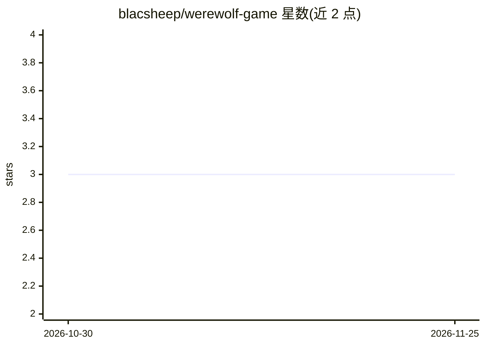

# blacsheep/werewolf-game

⭐ 3 · Python · MIT · 推送 2026-10-23 · [GitHub](https://github.com/blacsheep/werewolf-game) · 个人维护 · 中文 README

**12 个 AI 玩家的自动编排狼人杀，含配音与回放**

基于 agt 多 agent 框架的狼人杀对局系统：12 名 AI 玩家与 1 个 AI 上帝在群聊/私聊中互动，规则引擎（MCP 服务器）负责裁决，玩家座位间做信息隔离。每个动作写入哈希链事件日志，对局结束后自动生成整局语音（edge-tts）、可切换上帝/玩家视角的网页回放和上帝视角 mp4。支持 Linux/macOS，每座可配不同厂商模型；Windows 因依赖 fcntl 等接口暂不支持。仅提供 12 人预女猎守一种板子。

## 筛选速览

| 维度 | 判定 | 备注 |
|---|---|---|
| AI 角色 | `ai-native` | 本体是模型或模型工具 |
| 许可风险 | `permissive` | MIT |
| 部署形态 | `None` |  |
| 模型依赖 | — | README 未给出锁定关系 |
| 硬件要求 | — | 无带数字的原话,不猜 |
| 安装摩擦 | `medium` | 含编译或系统依赖之一 |
| 成熟度 | — | 结构信号不足 |

## 能力要点

- 上帝、玩家均为 agent，引擎裁决非法动作，信息按座位隔离
- 哈希链事件日志作为唯一事实来源，回放与视频按日志重算
- 每座可配不同厂商模型，终局揭晓各座对应模型
- 自动产出整局语音、网页回放与上帝视角 mp4

## 适用场景

- 一句话开一局全自动 AI 狼人杀并观看带配音回放
- 对比不同厂商模型在同一对局中的表现
- 基于哈希链事件日志做对局复盘与审计

## 场景标签

`多智能体` `语音合成` · 领域:Agent 开发

## 证据(README 行号)

> L3:  12 个 AI 玩家、1 个 AI 上帝，打完自动配音，生成可回放的对局。
> L12: 12 人预女猎守，由 AI 上帝主持，规则引擎裁决。你对 lead 说一句「开一局狼人杀」，组队、建群、主持、配音和出视频都由 agent 完成，中途不用人盯。项目基于 agt。

## 星数曲线

2026-10-30 3 → 2026-11-25 3（+0）

---
*卡片 v1 · prompt 1.4 · 生成 2026-11-22 · 置信度 high · 依据 README sha `e999c5eec6ca` · [字段定义](../../DATASET.md)*
