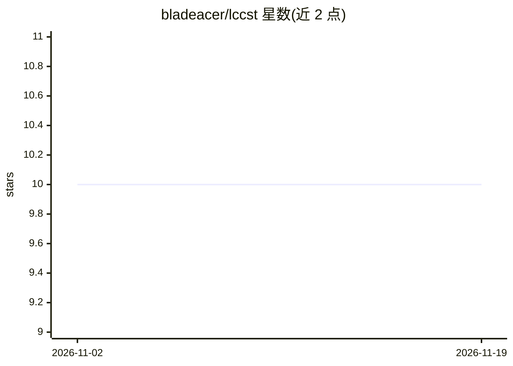

# bladeacer/lccst

⭐ 10 · TypeScript · MIT · 推送 2026-11-17 · [GitHub](https://github.com/bladeacer/lccst) · 个人维护

**给 AI agent 用的 Git 提交整理技能：把混乱 diff 分组为原子提交**

以 SKILL.md 技能文件与可选 MCP 服务器两种运行形态提供：将工作区变更按顶层目录做 Locality Clustering，生成经验证的原子提交计划，并执行 format/lint/test/build 质量门禁，强制单一职责、内聚与测试通过三条结构不变量。Bare Skill Mode 无服务器、无依赖，直接把技能文件载入 LLM 上下文；MCP 模式提供 init/audit/swarm/verify 等工具，需 Node.js>=20 与 pnpm 构建产物 dist/index.js。harness 默认禁用该服务器。

## 筛选速览

| 维度 | 判定 | 备注 |
|---|---|---|
| AI 角色 | `ai-native` | 本体是模型或模型工具 |
| 许可风险 | `permissive` | MIT |
| 部署形态 | `desktop` | 安装包/桌面程序 |
| 模型依赖 | — | README 未给出锁定关系 |
| 硬件要求 | — | 无带数字的原话,不猜 |
| 安装摩擦 | `low` | 无编译、无系统依赖或容器化 |
| 成熟度 | — | 结构信号不足 |

## 能力要点

- 两种运行形态：无依赖的 SKILL.md 裸载入与可选 MCP 服务器（11 个协议工具）
- 按顶层目录聚类的原子提交计划与单职责/内聚/测试验证三不变量
- Tooling Ladder 优先使用 Makefile/mise 等项目自身任务 runner
- 自带 clean-room 评测 playground，用 lccst-telemetry 测量运行时 token

## 适用场景

- 把积累的混乱工作区 diff 整理成可回滚的原子提交
- 在提交前强制跑项目自身的 lint/test/build 质量门禁
- 在 Claude Code、Copilot、Cursor 等 harness 中以技能文件接入提交规范

## 场景标签

`编码 Agent` · 领域:编码与开发

## 证据(README 行号)

> L5: lccst handles messy workspace diffs by grouping changed files into verified,
> L16: Load `SKILL.md` directly into the LLM context window. The model follows the
> L22: The MCP server at `src/index.ts` (built to `dist/index.js`) is an optional

## 星数曲线

2026-11-02 10 → 2026-11-19 10（+0）

---
*卡片 v1 · prompt 1.4 · 生成 2026-11-19 · 置信度 mid · 依据 README sha `824c355aac42` · [字段定义](../../DATASET.md)*
