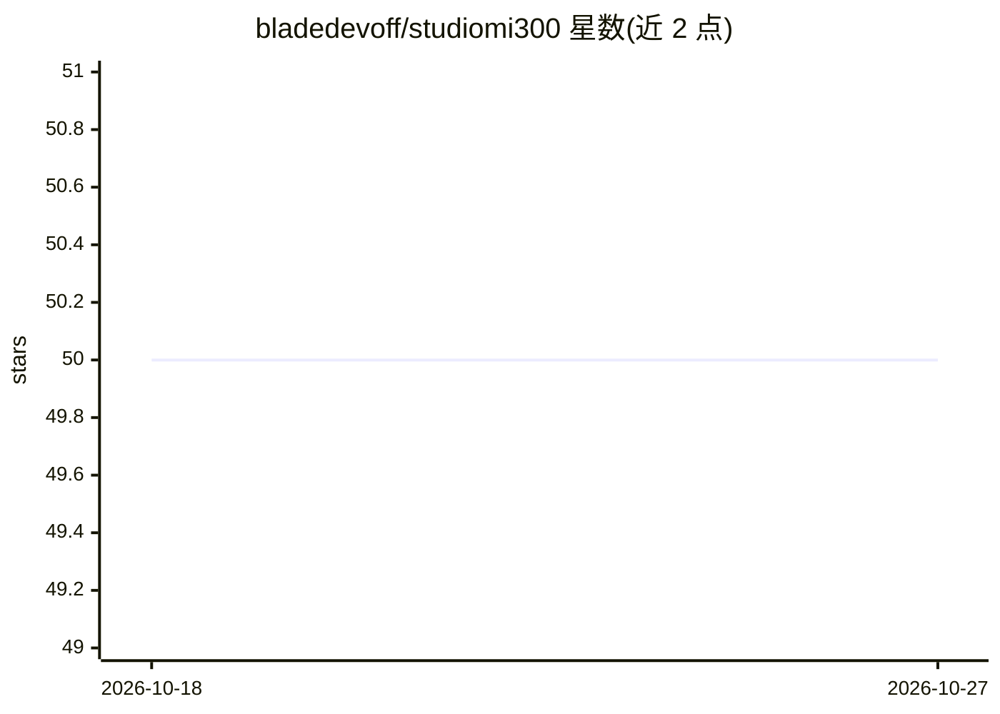

# bladedevoff/studiomi300

⭐ 50 · Python · MIT · 推送 2026-05-22 · [GitHub](https://github.com/bladedevoff/studiomi300) · [官网](https://huggingface.co/spaces/lablab-ai-amd-developer-hackathon/studiomi300) · 个人维护

**单张 AMD MI300X 上端到端生成 30 秒多镜头视频短片的流水线**

面向拥有 AMD Instinct MI300X 的开发者，用一条 prompt 生成含 6 个镜头、角色一致、配乐与旁白的 30 秒视频。流水线八阶段共用一卡：Qwen3.5-35B 作 Director 规划分镜并复用为 Vision Critic 打分重渲，FLUX.2 klein 出角色图与关键帧，Wan2.2-I2V 生成视频，ACE-Step 生成音乐，Kokoro 做多语言 TTS，ffmpeg 混流。全部模型 Apache 2.0/MIT，输出可商用。限制：仅在单张 MI300X 上测试，多 GPU 仅有钩子；需在 ROCm 容器内运行，端到端约 45 分钟。

## 筛选速览

| 维度 | 判定 | 备注 |
|---|---|---|
| AI 角色 | `ai-native` | 本体是模型或模型工具 |
| 许可风险 | `permissive` | MIT |
| 部署形态 | `library` | 以包/库形式分发 |
| 模型依赖 | local-ok | 支持本地模型 |
| 硬件要求 | — | 无带数字的原话,不猜 |
| 安装摩擦 | `medium` | 含编译或系统依赖之一 |
| 成熟度 | — | 结构信号不足 |

## 能力要点

- 八阶段（规划/图像/视频/评审/音乐/配音/混流）共享单张 192GB MI300X
- Director 与 Vision Critic 复用同一 Qwen3.5-35B 检查点，评分低于 7 自动重渲（最多 3 次）
- 视频后端通过 models.yaml 注册表可自定义，支持运行时切换与插件扩展
- 提供 CLI 与带 SSE 事件流的 FastAPI 任务 API
- 全部上游模型 Apache 2.0/MIT，输出可商用

## 适用场景

- 用一条 prompt 生成带配乐和旁白的多镜头叙事短片
- 在单张 MI300X 上跑通多模态生成全流程
- 通过 API 服务化提交视频生成任务并跟踪各阶段事件

## 场景标签

`视频生成` `语音合成` · 领域:内容生成

## 证据(README 行号)

> L9: One prompt → 30s cinematic reel. End-to-end on a single AMD Instinct MI300X.
> L36: 1. **Director** - `Qwen3.5-35B-A3B` via vLLM. Plans 6 shots, character portraits,
> L46: 6. **Music** - `ACE-Step v1` 3.5B, 30s instrumental from the brief.

## 星数曲线

2026-10-18 50 → 2026-10-27 50（+0）

---
*卡片 v1 · prompt 1.4 · 生成 2026-10-24 · 置信度 high · 依据 README sha `1240a74bc691` · [字段定义](../../DATASET.md)*
