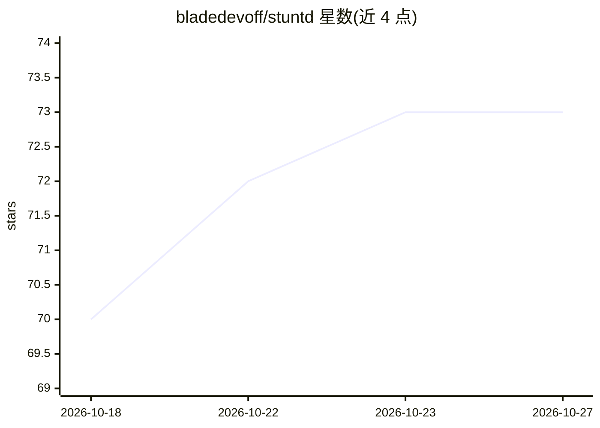

# bladedevoff/stuntd

⭐ 73 · Python · Apache-2.0 · 推送 2026-10-11 · [GitHub](https://github.com/bladedevoff/stuntd) · [官网](https://github.com/bladedevoff/stuntd) · 个人维护

**本地代理：学习应用的类型化 LLM 决策并在本地作答**

自托管本地代理，记录应用发出的类型化决策请求（Jev System One、OpenAI Decisions/Chat Completions、Anthropic Messages 协议），在每个决策点上蒸馏出冻结 Laya 编码器上的小型头部模型，置信度达标时在本地以数十毫秒作答，不确定的请求回传上游 provider。可无 key 本地运行 Laya 零样本，也可置于 OpenAI/Anthropic/付费 Jev API 之前边转发边学习。提供 pip 安装、CLI 与 Hugging Face Space 在线演示；自述为早期版本 v0.2.1，Decisions API 路径未对真实服务测试。

## 筛选速览

| 维度 | 判定 | 备注 |
|---|---|---|
| AI 角色 | `ai-ecosystem` | LLM/agent 周边工具 |
| 许可风险 | `permissive` | Apache-2.0 |
| 部署形态 | `library` | 以包/库形式分发 |
| 模型依赖 | — | README 未给出锁定关系 |
| 硬件要求 | — | 无带数字的原话,不猜 |
| 安装摩擦 | `medium` | 含编译或系统依赖之一 |
| 成熟度 | `idea` | |

## 能力要点

- 支持 Jev System One / OpenAI Decisions / Chat Completions / Anthropic Messages 四种协议
- 在冻结 Laya 编码器上按决策点训练本地头部，置信度校准后本地作答
- 无 key 本地零样本模式与可置于 provider 之前的代理模式
- Claude Code PreToolUse 钩子示例（约 50 ms 本地判定）

## 适用场景

- 把高频重复的路由/分流/审核类 LLM 决策改为本地作答以省 token
- 等待 Jev API 访问期间用本地 Laya 兼容端点保持 typesafe-sdk 可用
- 为 Claude Code 做本地 PreToolUse 命令门控

## 场景标签

`模型网关` · 领域:Agent 开发

## 证据(README 行号)

> L11: **stuntd is a local, self-hosted proxy that records the typed decisions your app already makes and
> L26: - **In front of OpenAI or Anthropic.** A drop-in replacement for the provider base URL. Typed
> L41:  moderation, gating. stuntd distils those answers into a local head: tens of milliseconds, no

## 星数曲线

2026-10-18 70 → 2026-10-27 73（+3）

---
*卡片 v1 · prompt 1.4 · 生成 2026-10-24 · 置信度 high · 依据 README sha `ba434262c8cc` · [字段定义](../../DATASET.md)*
