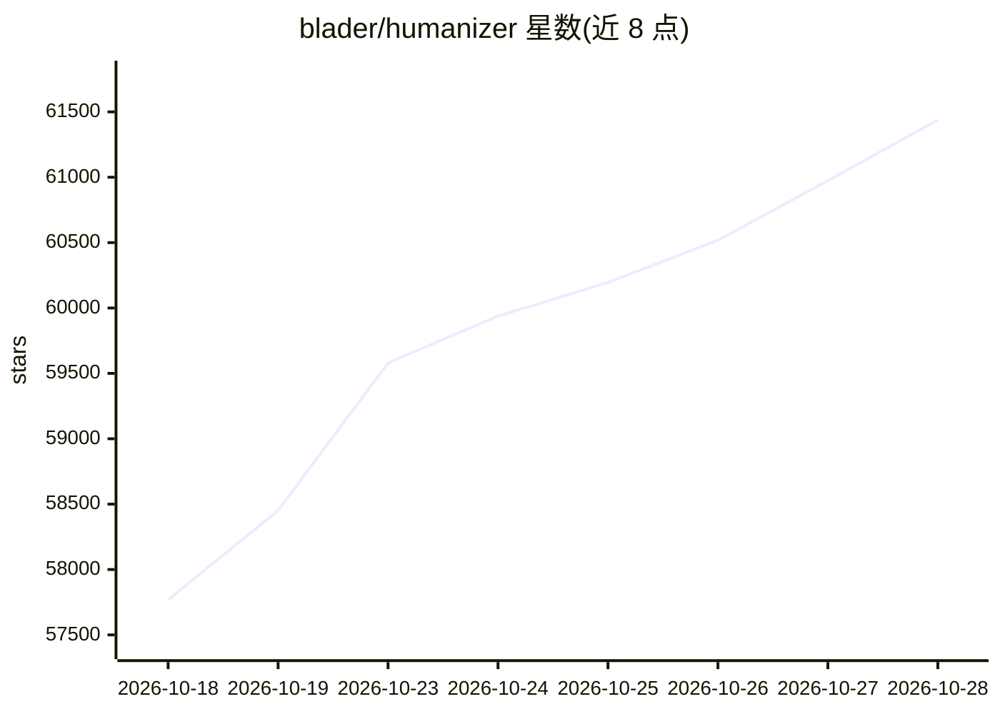

# blader/humanizer

⭐ 61,438 · Python · MIT · 推送 2026-10-16 · [GitHub](https://github.com/blader/humanizer) · [官网](https://skills.sh/blader/humanizer) · 个人维护

**面向 agent 用户的 AI 痕迹改写技能：按 Wikipedia 标准去除 AI 写作特征**

以 skill 形式运行的文本改写工具：基于 Wikipedia「Signs of AI writing」归纳的 26 种 AI 写作模式（分六类，含弱特征需共现才判定），逐条标注后重写，输出初稿、对残留人工痕迹的批评与终稿。可通过写作样本做声音匹配，改写文件时只改散文内容，保留代码、数据、frontmatter 与链接。要求事实细节必须来自原文或作者，缺失时询问而非编造。支持 Claude Code 插件、Codex、Claude.ai/Desktop 及 Skills CLI 覆盖的其他 agent。明确不以免过 AI 检测器为目标。

## 筛选速览

| 维度 | 判定 | 备注 |
|---|---|---|
| AI 角色 | `ai-enhanced` | 去掉 AI 部分产品仍成立 |
| 许可风险 | `permissive` | MIT |
| 部署形态 | `library` | 以包/库形式分发 |
| 模型依赖 | — | README 未给出锁定关系 |
| 硬件要求 | — | 无带数字的原话,不猜 |
| 安装摩擦 | `low` | 无编译、无系统依赖或容器化 |
| 成熟度 | — | 结构信号不足 |

## 动量与使用信号

- 维护:`active` — 距上次 push 1.5 天,年发版 6,22 位贡献者
- 涨星:近 1 天 **+400**(自 20261016 起算)
- 安装:npm 包 `skills` 月下载 23,786,800

## 能力要点

- 基于 Wikipedia「Signs of AI writing」的 26 种 AI 写作模式检测与改写
- 提供写作样本可做声音匹配（节奏、用词、标点）
- 改写文件时仅改散文，保留代码、数据、frontmatter、链接
- 事实细节不编造，缺失时向作者询问

## 适用场景

- 把 AI 起草的公告、博客改得更像人写的
- 在 Claude Code/Codex 等工具中以 /humanizer 直接调用
- 按自己的写作风格样本定制改写口吻
- 清理文档中的 AI 套话与格式化痕迹

## 场景标签

`AI 写作` · 领域:内容生成

## 证据(README 行号)

> L7: Humanizer makes AI-written text sound like a person wrote it, without changing what it says. It is built on Wikipedi
> L29: Humanizer checks for 26 patterns in all.
> L104: Humanizer marks every tell it finds, strongest first. It drafts a rewrite without treating the original structure 

## 星数曲线

2026-10-18 57,767 → 2026-10-28 61,438（+3,671）

---
*卡片 v1 · prompt 1.4 · 生成 2026-10-18 · 置信度 high · 依据 README sha `276617d2c31e` · [字段定义](../../DATASET.md)*
