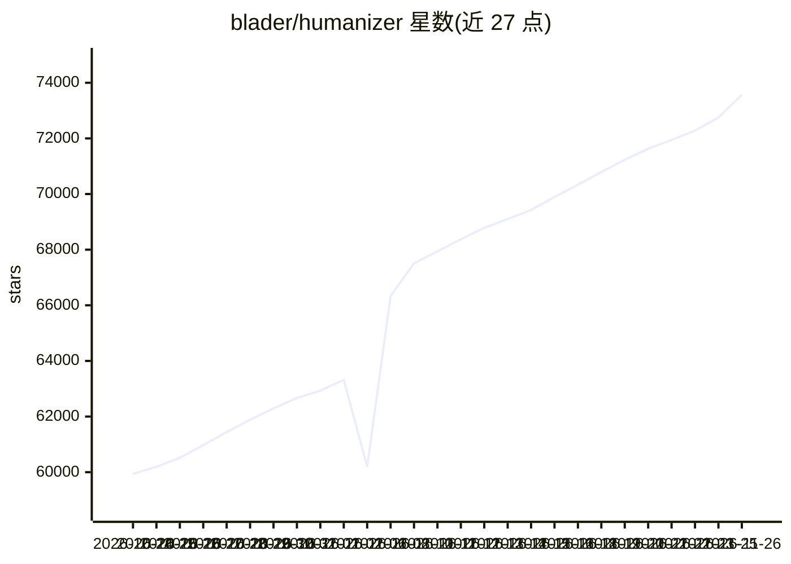

# blader/humanizer

⭐ 73,568 · Python · MIT · 推送 2026-11-19 · [GitHub](https://github.com/blader/humanizer) · [官网](https://skills.sh/blader/humanizer) · 个人维护

**为 agent 用户改写去除 AI 写作痕迹的技能**

以 Wikipedia《Signs of AI writing》为依据的 agent skill：按 26 类 AI 写作模式（如 Not X but Y、强行三段式、装饰性加粗）检测并改写文本，保留原文全部事实主张，支持通过写作样本匹配个人文风。安装后以 /humanizer 命令调用，可处理粘贴文本或指定文件（只改散文、不动代码与数据）。明确说明目标读者是人，不试图绕过 AI 检测器。支持 Claude Code 插件、Codex、pi 等多种 agent 安装方式。

## 筛选速览

| 维度 | 判定 | 备注 |
|---|---|---|
| AI 角色 | `ai-native` | 本体是模型或模型工具 |
| 许可风险 | `permissive` | MIT |
| 部署形态 | `library` | 以包/库形式分发 |
| 模型依赖 | — | README 未给出锁定关系 |
| 硬件要求 | — | 无带数字的原话,不猜 |
| 安装摩擦 | `low` | 无编译、无系统依赖或容器化 |
| 成熟度 | — | 结构信号不足 |

## 动量与使用信号

- 维护:`active` — 距上次 push 1.5 天,年发版 6,22 位贡献者
- 涨星:近 1 天 **+400**(自 20261016 起算)
- 安装:npm 包 `skills` 月下载 23,786,800

## 能力要点

- 基于 Wikipedia 编辑者使用的 26 类 AI 写作特征模式检测并改写
- 支持写作样本做个人文风匹配（节奏、用词、标点）
- 支持 Claude Code / Codex / Gemini CLI 等多 agent 安装
- 可处理文件，仅编辑散文、保留代码与数据

## 适用场景

- 把 AI 起草的公告或博客改写得更像人写的
- 统一自己文章的语气，去除 AI 腔
- 批量清理项目文档中的 AI 写作模式

## 场景标签

`AI 写作` · 领域:内容生成

## 证据(README 行号)

> L7: Humanizer makes AI-written text sound like a person wrote it, without changing what it says. It is built on Wikipedi
> L114: Humanizer marks every tell it finds, strongest first. It drafts a rewrite, merging, splitting, or reordering sente

## 星数曲线

2026-10-24 59,938 → 2026-11-26 73,568（+13,630）

---
*卡片 v1 · prompt 1.4 · 生成 2026-11-22 · 置信度 high · 依据 README sha `5ca5e01a9efb` · [字段定义](../../DATASET.md)*
