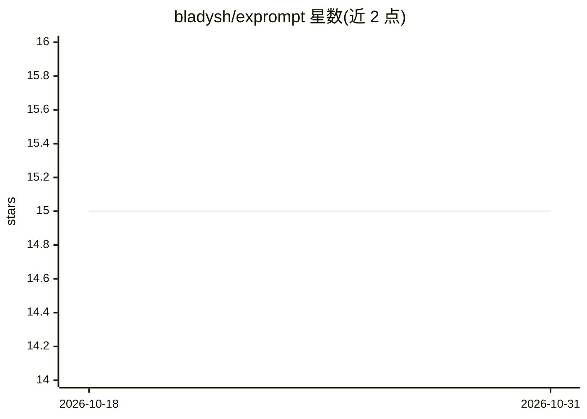

# bladysh/exprompt

⭐ 15 · Go · MIT · 推送 2026-05-17 · [GitHub](https://github.com/bladysh/exprompt) · [官网](https://exprompt.app) · 个人维护

**本地词典驱动的提示词压缩 CLI，为 LLM 用户缩减输入**

纯 Go 编写的命令行工具，在提示词发送给模型前用固定词典链（去填充词、缩写替换、元音删除等）压缩文本 25–50%，全程无 ML、无网络调用，输出确定性可复现。技术词（API/JSON/camelCase 等）通过锚点保护不被改写，支持 [[...]] 手动锚点与多趟迭代。以单二进制提供，支持 Homebrew/Scoop/预编译包/go install 安装，可写入 Claude Code 的 UserPromptSubmit hook 自动压缩，亦可作为 Go 库（pkg/exprompt）嵌入。限制：不做语义改写与翻译，vowels 过滤器为 BETA 且默认关闭。

## 筛选速览

| 维度 | 判定 | 备注 |
|---|---|---|
| AI 角色 | `ai-ecosystem` | LLM/agent 周边工具 |
| 许可风险 | `permissive` | MIT |
| 部署形态 | `desktop` | 安装包/桌面程序 |
| 模型依赖 | — | README 未给出锁定关系 |
| 硬件要求 | — | 无带数字的原话,不猜 |
| 安装摩擦 | `medium` | 含编译或系统依赖之一 |
| 成熟度 | — | 结构信号不足 |

## 能力要点

- 词典驱动确定性压缩，宣称缩小提示词 25–50%，本地运行无网络调用
- 锚点机制保护技术词（API/JSON/camelCase/数字/文件名）不被改写
- 提供 Claude Code hook 集成，提交提示词前自动压缩
- 提供 pkg/exprompt 公共 Go 库，可从自有代码调用压缩管线

## 适用场景

- 我在用 Claude Code 或其他 LLM 客户端时想压缩提示词以降低 API 费用
- 长对话/代码审查/RAG 场景下节省上下文窗口
- 在自有 Go 程序中嵌入提示词压缩管线

## 场景标签

`提示工程` · 领域:Agent 开发

## 证据(README 行号)

> L6: Free, open-source CLI proxy prompt compressor for your AI prompts and agents.
> L28: A tiny CLI that **shrinks AI prompts by 25–50%** before they reach the model. It removes filler words, replaces com

## 星数曲线

2026-10-18 15 → 2026-10-31 15（+0）

---
*卡片 v1 · prompt 1.4 · 生成 2026-10-30 · 置信度 high · 依据 README sha `ed37c84ec23d` · [字段定义](../../DATASET.md)*
