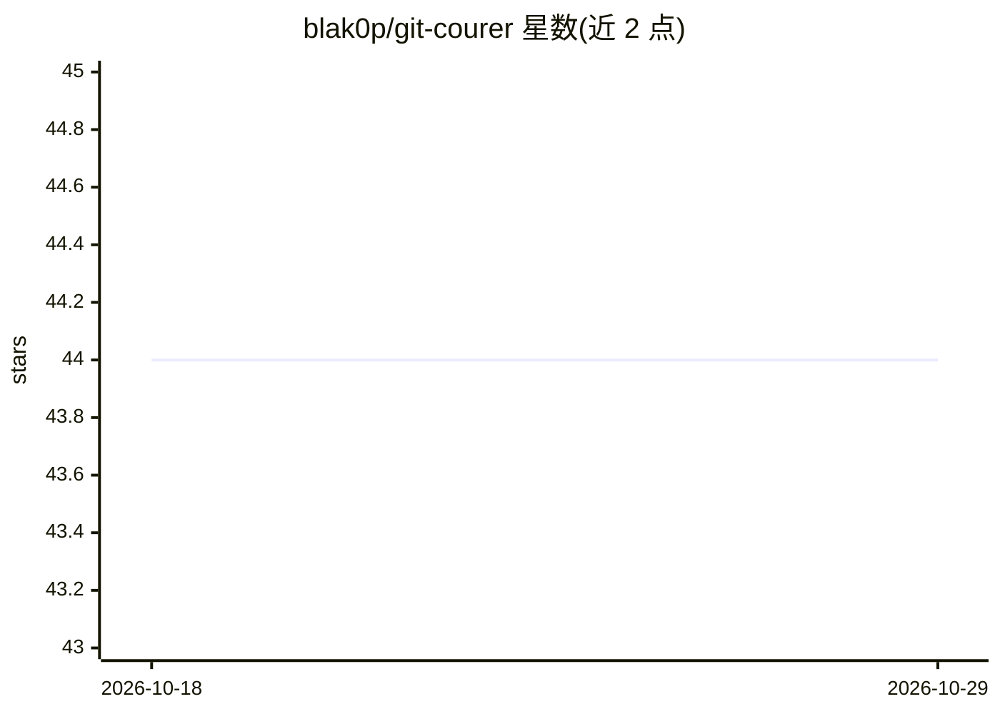

# blak0p/git-courer

⭐ 44 · Go · MIT · 推送 2026-10-23 · [GitHub](https://github.com/blak0p/git-courer) · [官网](https://blak0p.github.io/git-courer/) · 个人维护

**给 AI agent 用的 Git MCP 服务器，本地运行零 token 成本**

Go 编写的 MCP 服务器，向 AI agent 暴露 13 个结构化 Git 工具（status/diff/commit/branch/session 等），JSON 进 JSON 出，不经过 Bash。机制包括：写操作前自动备份可一键撤销、依赖图拆分原子提交、Go AST 决定 commit 类型（LLM 只写消息）、隔离 worktree 会话、commit 存于 refs/courer/* 使 changelog 在 squash/rebase 后仍存在。支持 Ollama 本地 LLM，可通过 llm.enabled: false 完全关闭 LLM（release 功能不可用）。自动配置 OpenCode、Claude Code、Codex、pi、Antigravity 五种客户端。

## 筛选速览

| 维度 | 判定 | 备注 |
|---|---|---|
| AI 角色 | `ai-ecosystem` | LLM/agent 周边工具 |
| 许可风险 | `permissive` | MIT |
| 部署形态 | `library` | 以包/库形式分发 |
| 模型依赖 | local-ok | 支持本地模型 |
| 硬件要求 | — | 无带数字的原话,不猜 |
| 安装摩擦 | `low` | 无编译、无系统依赖或容器化 |
| 成熟度 | — | 结构信号不足 |

## 能力要点

- 13 个结构化 MCP 工具覆盖 Git 全操作面，不经 Bash
- 每次写操作前自动备份，backup RESTORE 可撤销
- commit 类型由 Go AST 分析决定，LLM 只写消息，可完全关闭 LLM
- 隔离 worktree 会话与 refs/courer/* 存储，changelog 在 squash/rebase 后保留

## 适用场景

- 让编码 agent 通过结构化接口安全操作 Git 仓库
- 多 agent 并行开发时用隔离 worktree 避免互相干扰
- 无 GPU 笔记本上零 token 成本生成本地 commit 与 changelog

## 场景标签

 · 领域:开发者工具/agent 基础设施

## 证据(README 行号)

> L30: An MCP server that gives AI agents a full, safe interface to Git — not just commits, the whole surface: status, dif
> L159: |`commit`|`PREVIEW` → `APPLY`|3-phase LLM pipeline: preview, review, apply|

## 星数曲线

2026-10-18 44 → 2026-10-29 44（+0）

---
*卡片 v1 · prompt 1.4 · 生成 2026-10-25 · 置信度 high · 依据 README sha `67efd8523a2d` · [字段定义](../../DATASET.md)*
