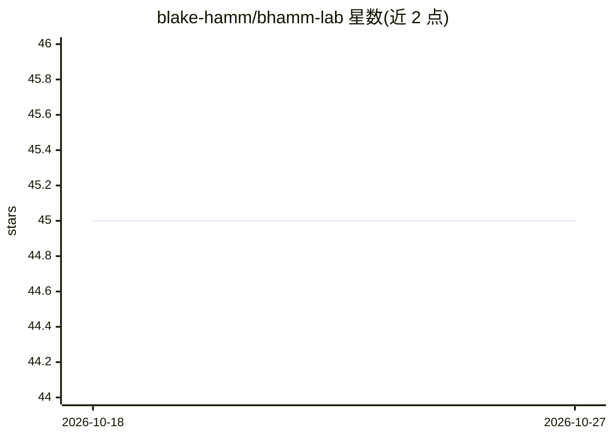

# blake-hamm/bhamm-lab

⭐ 45 · Nix · BSD-3-Clause · 推送 2026-10-26 · [GitHub](https://github.com/blake-hamm/bhamm-lab) · [官网](https://docs.bhamm-lab.com/) · 个人维护

**个人 homelab 基础设施即代码仓库：5 台服务器上的 AI/ML 与 DevOps 平台**

个人维护的 homelab 单体仓库，以一切皆代码方式管理 5 台物理服务器（Debian/Proxmox/Talos/NixOS/TrueNAS），涵盖 Ceph 存储、Talos Kubernetes、OpenTofu/Ansible/ArgoCD 自动化、Vault/Authelia/Traefik 安全栈与 3-2-1 备份。AI/ML 部分：llm-models Helm chart 通过 KubeElasti 实现 Llama.cpp 弹性推理并经 LiteLLM 路由，AMD/Intel GPU 加速嵌入与 MoE 推理，另接入 GCP Vertex AI。非可安装的软件产品，而是环境配置代码。

## 筛选速览

| 维度 | 判定 | 备注 |
|---|---|---|
| AI 角色 | `ai-ecosystem` | LLM/agent 周边工具 |
| 许可风险 | `permissive` | BSD-3-Clause |
| 部署形态 | `library` | 以包/库形式分发 |
| 模型依赖 | — | README 未给出锁定关系 |
| 硬件要求 | — | 无带数字的原话,不猜 |
| 安装摩擦 | `low` | 无编译、无系统依赖或容器化 |
| 成熟度 | — | 结构信号不足 |

## 能力要点

- llm-models Helm chart：KubeElasti 缩容到零的 Llama.cpp 推理，经 LiteLLM 路由
- AMD ROCm operator 与 Intel GPU plugin 管理推理加速设备
- OpenTofu/Ansible/ArgoCD 全声明式基础设施与 GitOps 部署
- Ceph/TrueNAS 分层存储与 3-2-1 备份、灾难恢复演练

## 适用场景

- 参考自建 GPU 推理平台的 IaC 组织方式
- 了解 homelab 中 Talos/K8s/存储/安全的组合实践
- 作为个人基础设施与 GitOps 的作品集参考

## 场景标签

 · 领域:自托管基础设施/DevOps

## 证据(README 行号)

> L23: * **Accelerated AI/ML:** The environment is specifically tailored for AI/ML workloads, with a focus on leveraging A
> L46: - 📦 `llm-models` Helm chart – KubeElasti scale‑to‑zero Llama.cpp inference routed through LiteLLM

## 星数曲线

2026-10-18 45 → 2026-10-27 45（+0）

---
*卡片 v1 · prompt 1.4 · 生成 2026-10-25 · 置信度 mid · 依据 README sha `82558e2d001e` · [字段定义](../../DATASET.md)*
