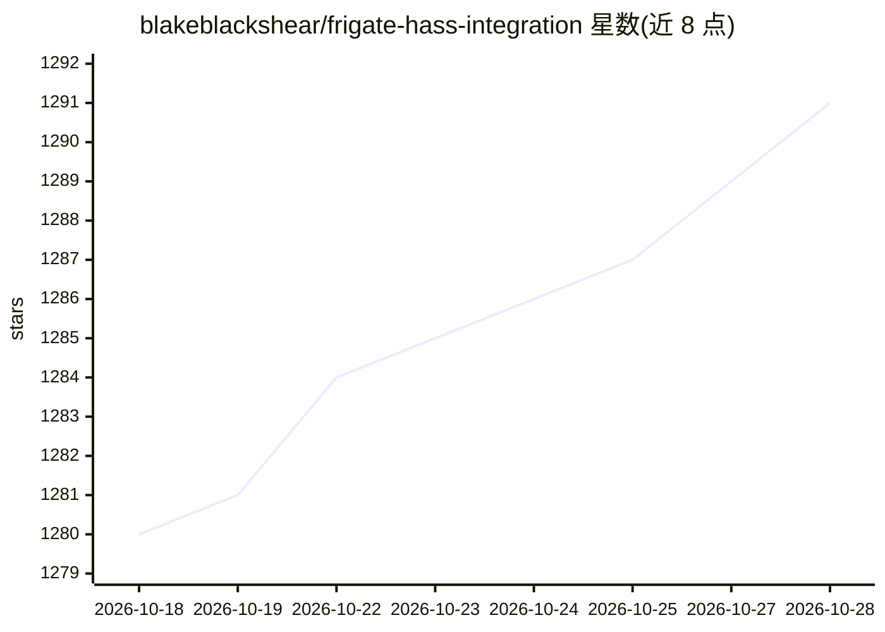

# blakeblackshear/frigate-hass-integration

⭐ 1,291 · Python · MIT · 推送 2026-10-27 · [GitHub](https://github.com/blakeblackshear/frigate-hass-integration) · 个人维护

**把 Frigate NVR 接入 Home Assistant 的集成组件**

Frigate 与 Home Assistant 之间的集成组件：为 Home Assistant 提供带缩略图与导航的媒体浏览器、摄像头/检测 FPS 等传感器实体、物体运动二值传感器、摄像头实体（实时视图、检测快照）、录像/检测/快照等开关实体，以及手动事件与 PTZ 控制服务；支持多 Frigate 实例。安装主要通过 HACS，或手动复制 custom_components 目录；依赖 Home Assistant 的 mqtt 集成且需手动配置。由 Blake Blackshear 等三人维护。

## 筛选速览

| 维度 | 判定 | 备注 |
|---|---|---|
| AI 角色 | `ai-ecosystem` | LLM/agent 周边工具 |
| 许可风险 | `permissive` | MIT |
| 部署形态 | `None` |  |
| 模型依赖 | — | README 未给出锁定关系 |
| 硬件要求 | — | 无带数字的原话,不猜 |
| 安装摩擦 | `low` | 无编译、无系统依赖或容器化 |
| 成熟度 | — | 结构信号不足 |

## 能力要点

- 提供媒体浏览器、传感器、二值传感器、摄像头、开关等实体
- 支持控制摄像头的服务（手动事件、PTZ 控制）
- 支持多个 Frigate 实例
- 通过 HACS 或手动复制 custom_components 安装

## 适用场景

- 在 Home Assistant 中查看 Frigate 摄像头的实时画面与检测快照
- 基于物体检测传感器构建自动化联动
- 在 Home Assistant 中开关录像、检测与快照功能

## 场景标签

 · 领域:智能家居/视频监控

## 证据(README 行号)

> L18: - Sensor entities (Camera FPS, Detection FPS, Process FPS, Skipped FPS, Objects detected)
> L19: - Binary Sensor entities (Object motion)
> L20: - Camera entities (Live view, Object detected snapshot)

## 星数曲线

2026-10-18 1,280 → 2026-10-28 1,291（+11）

---
*卡片 v1 · prompt 1.4 · 生成 2026-10-21 · 置信度 mid · 依据 README sha `e0ecbc6df818` · [字段定义](../../DATASET.md)*
