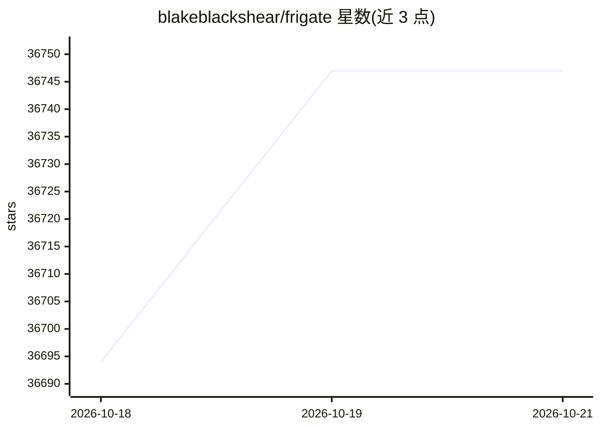

# blakeblackshear/frigate

⭐ 36,747 · Python · MIT · 推送 2026-10-19 · [GitHub](https://github.com/blakeblackshear/frigate) · [官网](https://frigate.video) · 组织维护 · 中文 README

**本地实时目标检测的 IP 摄像头 NVR**

面向 Home Assistant 的完全本地化 NVR，使用 OpenCV 与 TensorFlow 对 IP 摄像头画面做实时目标检测，无需将视频上传云端。通过自定义组件与 Home Assistant 集成，以低开销运动检测决定何时何地运行目标检测，经 MQTT 与其他系统通信。支持基于检测对象的录像保留策略、24/7 录像、RTSP 转流及 WebRTC/MSE 低延迟实时查看。文档注明建议使用 GPU 或 AI 加速器以获得更好效果。

## 筛选速览

| 维度 | 判定 | 备注 |
|---|---|---|
| AI 角色 | `ai-native` | 本体是模型或模型工具 |
| 许可风险 | `permissive` | MIT |
| 部署形态 | `None` |  |
| 模型依赖 | — | README 未给出锁定关系 |
| 硬件要求 | — | 无带数字的原话,不猜 |
| 安装摩擦 | `low` | 无编译、无系统依赖或容器化 |
| 成熟度 | — | 结构信号不足 |

## 动量与使用信号

- 维护:`active` — 距上次 push 1.4 天,年发版 8,411 位贡献者
- 涨星:近 1 天 **+55**(自 20261016 起算)
- 安装:github 包 `release-assets` 月下载无数据

## 能力要点

- 本地运行 TensorFlow 实时目标检测
- 与 Home Assistant 通过自定义组件紧密集成
- MQTT 通信，便于接入其他系统
- RTSP 转流与 WebRTC/MSE 低延迟实时查看

## 适用场景

- 为 Home Assistant 智能家庭添加摄像头目标检测
- 本地录像并按检测对象设置保留策略
- 多摄像头实时查看与回放检索

## 场景标签

`目标检测` · 领域:感知与多模态

## 证据(README 行号)

> L13: A complete and local NVR designed for Home Assistant with AI object detection. Uses OpenCV and Tensorflow to perfor
> L15: Use of a GPU or AI accelerator is highly recommended. AI accelerators will outperform even the best CPUs with very 

## 星数曲线

2026-10-18 36,694 → 2026-10-21 36,747（+53）

---
*卡片 v1 · prompt 1.4 · 生成 2026-10-18 · 置信度 high · 依据 README sha `14bee4f8be37` · [字段定义](../../DATASET.md)*
