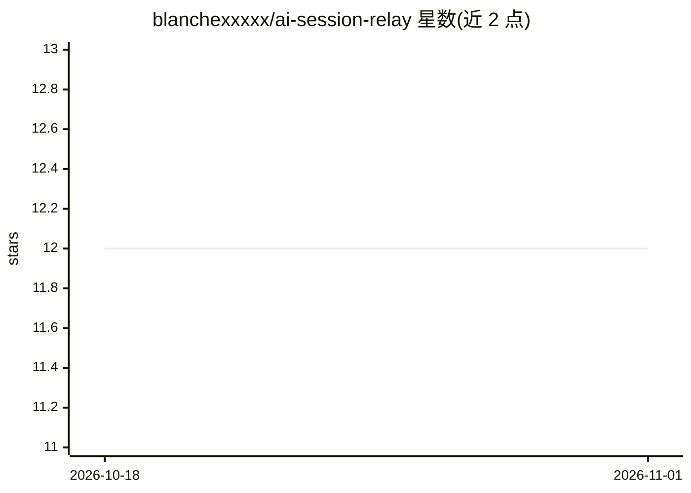

# blanchexxxxx/ai-session-relay

⭐ 12 · Python · AGPL-3.0 · 推送 2026-10-12 · [GitHub](https://github.com/blanchexxxxx/ai-session-relay) · 个人维护 · 中文 README

**本地 HTTP 中继：为 Claude Code 与 Codex 保持会话并跨引擎切换**

一个仅监听 loopback 的本地 HTTP/NDJSON 服务，无 Web UI、数据库与账号系统。它维护 Claude Code 会话指针与 Codex thread 指针，实现服务重启后的续接、会话过大时的轮次裁剪重开，以及在两引擎间切换时通过单一 /chat_stream 接口传递有界 handoff 上下文。面向已有前端或自建接入的开发者，通过 git clone 与 install.sh 安装，Linux 下自动注册 systemd user service；Windows 需在 WSL2 内运行。

## 筛选速览

| 维度 | 判定 | 备注 |
|---|---|---|
| AI 角色 | `ai-ecosystem` | LLM/agent 周边工具 |
| 许可风险 | `viral` | AGPL-3.0 |
| 部署形态 | `None` |  |
| 模型依赖 | locked-api |  |
| 硬件要求 | — | 无带数字的原话,不猜 |
| 安装摩擦 | `low` | 无编译、无系统依赖或容器化 |
| 成熟度 | — | 结构信号不足 |

## 能力要点

- 单一 /chat_stream 端点支持 Claude Code 与 Codex 双引擎无缝切换（epoch 递增+有界 handoff）
- 会话指针持久化：重启服务/机器后下一条消息继续原 session/thread
- Codex 侧含 between-turn pre-rotation、rollout 恢复与原子指针切换
- 仅监听 127.0.0.1，无 CORS，官方建议经自有后端或 Tailscale 代理

## 适用场景

- 让手机/远程前端连接家里常开机器上的 Claude/Codex
- 在 Claude Code 与 Codex 之间切换时保留最近上下文
- 避免会话过长撞上下文窗口，自动续接新 session

## 场景标签

`模型网关` · 领域:Agent 开发

## 证据(README 行号)

> L3: A small, frontend-agnostic relay that keeps Claude Code sessions and Codex threads alive, then hands recent context 
> L5: It is intentionally only a local HTTP/NDJSON service. There is no web UI, database, account system, memory product, 
> L243: 这个库没有前端。现有前端只需要接一个 `POST http://127.0.0.1:8900/chat_stream`：

## 星数曲线

2026-10-18 12 → 2026-11-01 12（+0）

---
*卡片 v1 · prompt 1.4 · 生成 2026-11-01 · 置信度 high · 依据 README sha `f59ee8c41ea5` · [字段定义](../../DATASET.md)*
