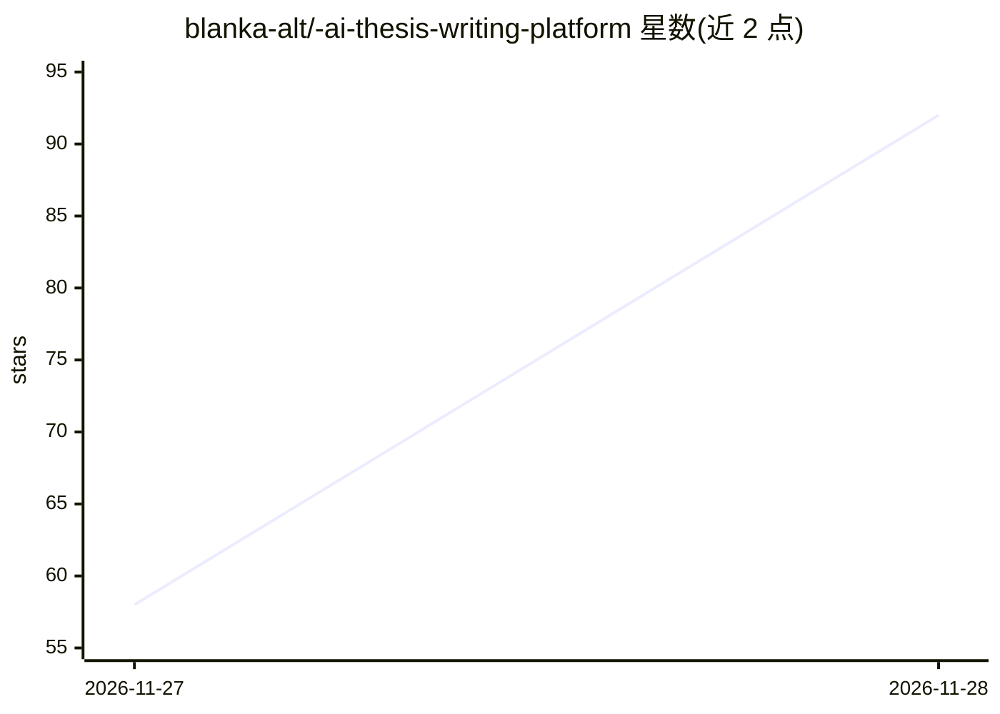

# blanka-alt/-ai-thesis-writing-platform

⭐ 92 · 推送 2026-11-25 · [GitHub](https://github.com/blanka-alt/-ai-thesis-writing-platform) · [官网](https://mysoul.echomysoul.us.kg/) · 个人维护 · 中文 README

**面向教培/创业团队的 AI 论文写作平台源码（OEM 白标）**

提供论文写作全链路平台源码：开题报告、文献综述、论文辅助写作、分步向导、降重/降AIGC、答辩PPT 生成、问卷调查等功能。技术栈为 Vue + SpringBoot + Django + MySQL。商业上分为旗舰版与 PRO 升级版两档，均含源码交付与 OEM 白标；PRO 增加无限改稿、格式排版、科研绘图、全文翻译与 SaaS 分销系统。README 以功能对比表与购买咨询入口为主，未给出本地部署命令或安装步骤。

## 筛选速览

| 维度 | 判定 | 备注 |
|---|---|---|
| AI 角色 | `ai-native` | 本体是模型或模型工具 |
| 许可风险 | `none` | — |
| 部署形态 | `None` |  |
| 模型依赖 | — | README 未给出锁定关系 |
| 硬件要求 | — | 无带数字的原话,不猜 |
| 安装摩擦 | `low` | 无编译、无系统依赖或容器化 |
| 成熟度 | — | 结构信号不足 |

## 能力要点

- 覆盖开题/综述/写作/降重/降AIGC/答辩PPT 的写作链路
- 旗舰版与 PRO 双版本，均含源码交付与 OEM 白标
- PRO 含 SaaS 分销系统与 6 个月调试服务
- Vue + SpringBoot + Django + MySQL 技术栈

## 适用场景

- 教培机构白标部署自己的论文写作平台
- 搭建带会员/套餐/订单系统的写作服务站点
- 为代理/分销模式运营一个多商户写作平台

## 场景标签

`AI 写作` `科研工具` · 领域:内容生成

## 证据(README 行号)

> L12:  学成写作 · AI 论文写作平台源码： 覆盖「写 → 改 → 排 → 降 → 检 → 答辩 → 分销」全链路。面向教培机构、流量主、创业团队的 OEM 白标 / 源码交付 方案，两档版本一眼选型。
> L15:  🌐 立即体验： https://mysoul.echomysoul.us.kg

## 星数曲线

2026-11-27 58 → 2026-11-28 92（+34）

---
*卡片 v1 · prompt 1.4 · 生成 2026-11-27 · 置信度 mid · 依据 README sha `fd747b4f7d54` · [字段定义](../../DATASET.md)*
