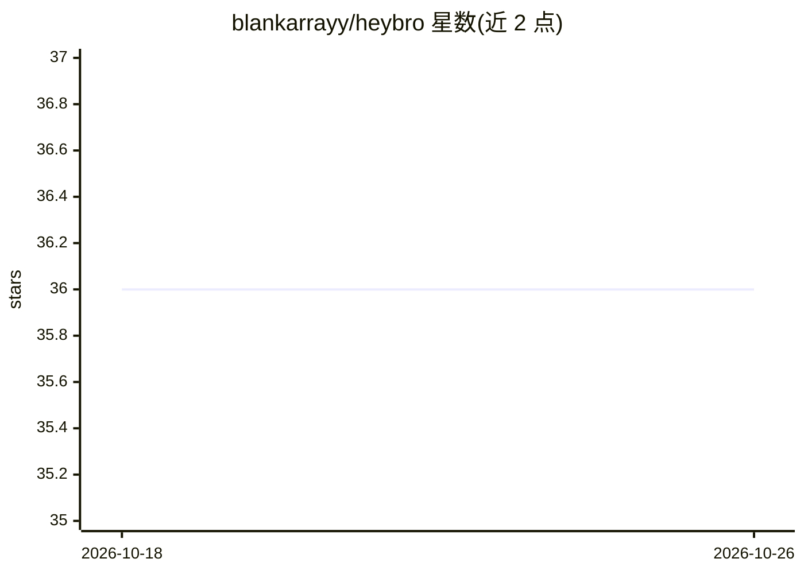

# blankarrayy/heybro

⭐ 36 · Kotlin · 推送 2026-01-27 · [GitHub](https://github.com/blankarrayy/heybro) · [官网](https://youtu.be/b0q0bHPGtck) · 个人维护

**免 Root 的 Android 独立 AI agent，按指令代操作手机**

Flutter + Kotlin 构建的 Android 应用：在设备端通过 Google Gemini 理解用户指令，借助无障碍服务与悬浮窗权限读取屏幕并代为点击，完成发 WhatsApp 消息、转账、发邮件、拍照等任务；支持语音指令（需 Porcupine API key，应用须保持打开）。配置需在应用内填入 Google Service Account 凭证并启用 Vertex AI API。README 声明为实验性学习项目，不保证日常可靠使用。通过 git clone 源码以 flutter run 运行或构建 APK 手动安装。

## 筛选速览

| 维度 | 判定 | 备注 |
|---|---|---|
| AI 角色 | `ai-native` | 本体是模型或模型工具 |
| 许可风险 | `none` | — |
| 部署形态 | `None` |  |
| 模型依赖 | — | README 未给出锁定关系 |
| 硬件要求 | — | 无带数字的原话,不猜 |
| 安装摩擦 | `low` | 无编译、无系统依赖或容器化 |
| 成熟度 | `idea` | |

## 能力要点

- 免 Root、免电脑，设置后可独立运行于 Android 设备
- 通过无障碍服务与悬浮窗权限读取屏幕并执行点击操作
- 使用 Google Gemini（Vertex AI + Service Account）作为模型来源
- 可选 Porcupine 语音指令输入

## 适用场景

- 用自然语言让手机代发 WhatsApp 消息或邮件
- 通过语音指令让手机执行拍照等操作
- 体验和学习设备端 AI agent 的自动化控制实现

## 场景标签

`GUI 自动化` · 领域:效率与自动化

## 证据(README 行号)

> L9: **HeyBro** is a standalone AI agent that controls your phone directly to complete tasks for you. It can automaticall
> L19:  * **AI-Powered:** Uses Google Gemini AI to understand what you want.
> L20:  * **Full Control:** Uses Accessibility and Overlay permissions to see your screen and tap buttons for you.

## 星数曲线

2026-10-18 36 → 2026-10-26 36（+0）

---
*卡片 v1 · prompt 1.4 · 生成 2026-10-25 · 置信度 high · 依据 README sha `6c24f6b4b88c` · [字段定义](../../DATASET.md)*
