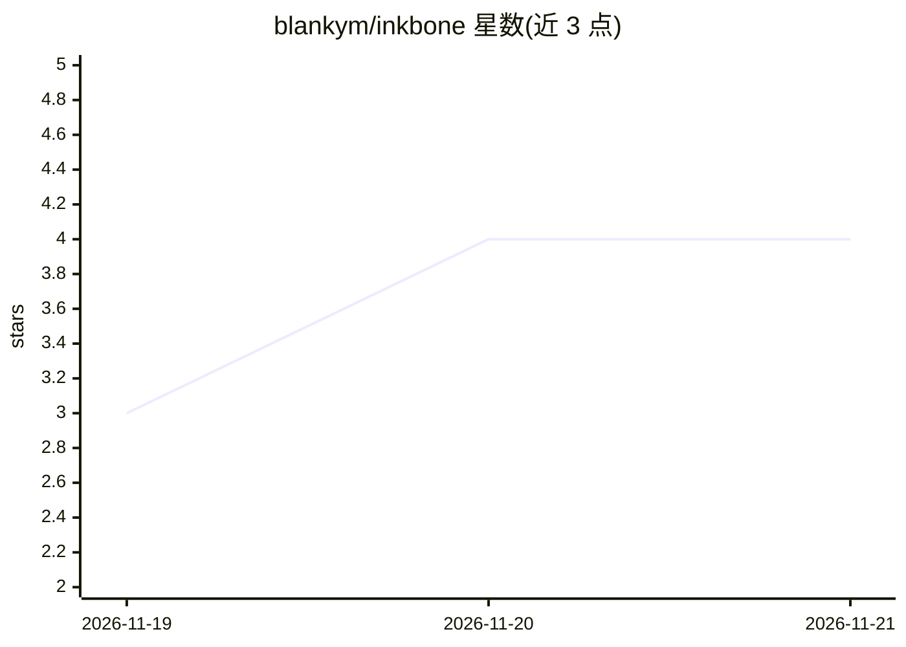

# blankym/inkbone

⭐ 4 · JavaScript · MIT · 推送 2026-11-20 · [GitHub](https://github.com/blankym/inkbone) · [官网](https://blankym.github.io/inkbone/) · 个人维护 · 中文 README

**中文长篇小说写作的 AI 配套质检与账本工具集**

面向用大模型写中文长篇连载的作者：写前由脚本编排防剧透上下文（packet 遮蔽未揭露真相、提醒到期伏笔），写后由零依赖本地引擎按词表、角色台账、历法与主语链逐行检查套话、吃书与语域问题。提供四条入口：纯浏览器试跑台/整书体检（零上传）、Agent Skill 安装、stdio MCP 三件套（9 Tools + 8 Prompts + 11 Resources）、VS Code 扩展与 26 条 CLI 命令。需 Node.js ≥18，支持简繁识别与按起点/番茄/七猫/晋江规范导出。

## 筛选速览

| 维度 | 判定 | 备注 |
|---|---|---|
| AI 角色 | `ai-ecosystem` | LLM/agent 周边工具 |
| 许可风险 | `permissive` | MIT |
| 部署形态 | `library` | 以包/库形式分发 |
| 模型依赖 | — | README 未给出锁定关系 |
| 硬件要求 | — | 无带数字的原话,不猜 |
| 安装摩擦 | `low` | 无编译、无系统依赖或容器化 |
| 成熟度 | — | 结构信号不足 |

## 能力要点

- 活账本闭环：未到 revealChapter 自动遮蔽，已阵亡角色再出场预警
- verify-review 核验审读引文是否在正文，拦截越权文评
- 零第三方依赖的 stdio MCP Server（9 Tools + 8 Prompts + 11 Resources）
- 纯浏览器本地运行试跑台，正文不上传

## 适用场景

- 给 AI 生成的网文章节逐行体检、生成精准局部改稿 Prompt
- 长篇连载防吃书：维护角色台账与伏笔状态
- 把存量百章书稿回填台账并做增量体检
- 按网文平台规范清洗导出投稿稿

## 场景标签

`AI 写作` · 领域:内容生成

## 证据(README 行号)

> L21: |**Claude Code / Codex / Antigravity / OpenCode**|`npx skills add blankym/inkbone`|8 阶段完整写作工作流 + 活账本防剧透 + 本地自动质检 + 
> L22: |**Claude Desktop / Cursor / Windsurf（MCP）**|配一段 `npx -y inkbone mcp`|一个配置拿齐 **9 Tools + 8 Prompts + 11 Resources**
> L155: InkBone 内置**零第三方依赖**的完整 `stdio MCP Server`。挂载后无需重复安装 Skill，即可一次性获得：

## 星数曲线

2026-11-19 3 → 2026-11-21 4（+1）

---
*卡片 v1 · prompt 1.4 · 生成 2026-11-21 · 置信度 high · 依据 README sha `79970e2dc09f` · [字段定义](../../DATASET.md)*
