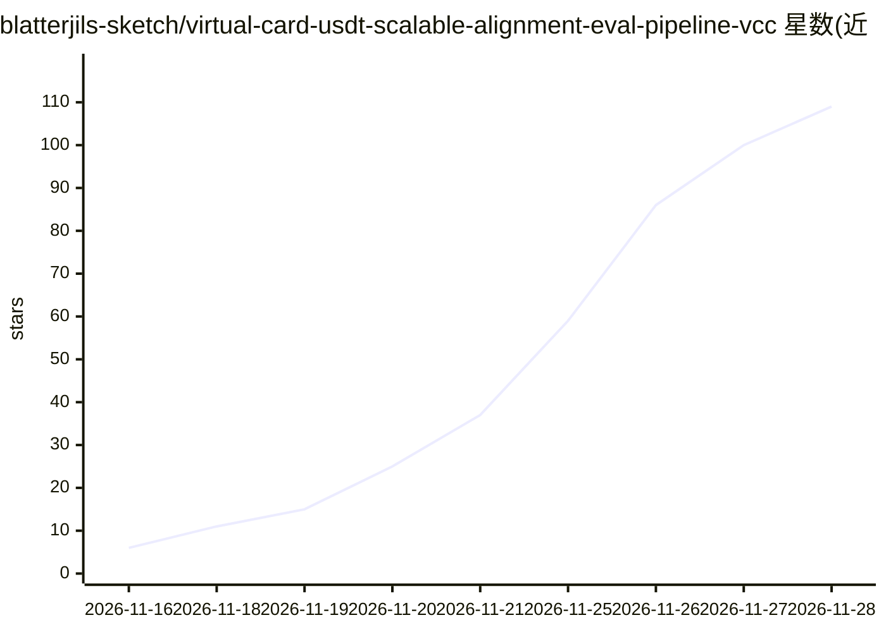

# blatterjils-sketch/virtual-card-usdt-scalable-alignment-eval-pipeline-vcc

⭐ 109 · 推送 2026-11-16 · [GitHub](https://github.com/blatterjils-sketch/virtual-card-usdt-scalable-alignment-eval-pipeline-vcc) · [官网](https://app.coregold.io/signup?invite_code=ADvlj9b) · 个人维护 · 中文 README

**用 CoreGold 虚拟卡为 AI 评估批跑提供预算限额与资金管理**

面向企业与研究机构的批量模型评估场景，说明如何以 CoreGold 商业虚拟卡（VCC）配合 USDT 入金，为红队对抗基准压测设置单批次硬限额、用后注销回收残额，并覆盖 Stripe/AVS 核验、Apple Pay 绑定与链上实时充值等流程。内容以营销解析形式呈现，给出三步开卡部署流程与开卡控制台入口，未提供可运行的代码或开源工具本体。

## 筛选速览

| 维度 | 判定 | 备注 |
|---|---|---|
| AI 角色 | `ai-enhanced` | 去掉 AI 部分产品仍成立 |
| 许可风险 | `none` | — |
| 部署形态 | `None` |  |
| 模型依赖 | — | README 未给出锁定关系 |
| 硬件要求 | — | 无带数字的原话,不猜 |
| 安装摩擦 | `low` | 无编译、无系统依赖或容器化 |
| 成熟度 | — | 结构信号不足 |

## 能力要点

- 单卡硬限额机制：累计扣款达上限即拒绝交易终止脚本
- 用后销卡，残额退回主资金池
- 支持 USDT（TRC20/ERC20）链上充值折算 USD
- 宣称美国商业 BIN 与 AVS 地址以通过支付核验

## 适用场景

- 批量跑模型评估时给每批次算力消费设上限
- 避免评估脚本死循环导致持续扣费
- 向 API 计费后台绑定一次性支付卡

## 场景标签

 · 领域:支付/金融工具（面向 AI 评估场景）

## 证据(README 行号)

> L3: # ⚡ 大规模 AI 安全对齐与基准压测：用 CoreGold 虚拟卡（VCC）给批量评估管线装上“自动熔断器”
> L13: 1. **单批次硬限额，死循环直接物理掐断**
> L24: 1. **USDT 入金**：登录 CoreGold 官方控制台，进 **`资产管理`** 充入 **USDT**。

## 星数曲线

2026-11-16 6 → 2026-11-28 109（+103）

---
*卡片 v1 · prompt 1.4 · 生成 2026-11-18 · 置信度 mid · 依据 README sha `4126627137ee` · [字段定义](../../DATASET.md)*
