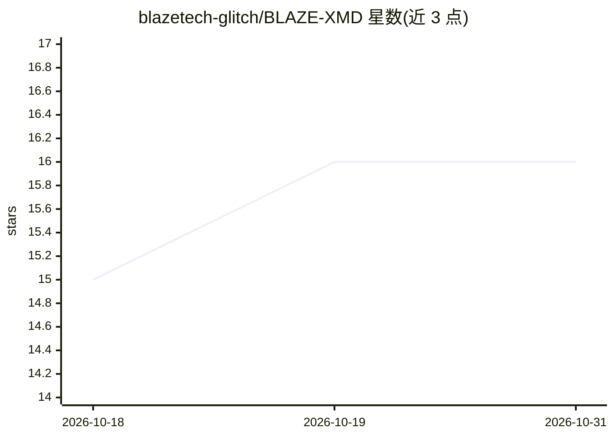

# blazetech-glitch/BLAZE-XMD

⭐ 16 · JavaScript · MIT · 推送 2026-10-14 · [GitHub](https://github.com/blazetech-glitch/BLAZE-XMD) · [官网](Blaze-xmd.zone.id) · 个人维护

**基于 Baileys 的 WhatsApp 自动化机器人**

Node.js 编写的模块化 WhatsApp 自动化项目，基于 Baileys 库实现，提供命令插件、群组工具、媒体工具、搜索功能与可配置的机器人行为；命令以插件形式组织，可在不改动现有命令注册表的情况下添加新命令。面向想自建 WhatsApp 机器人的用户，部署流程为 Fork 仓库、通过配对站点获取 Session ID、部署到 Heroku 或下载 ZIP 运行。README 未给出 AI 功能的具体机制说明，仅在主题标签与简介中提及 AI。

## 筛选速览

| 维度 | 判定 | 备注 |
|---|---|---|
| AI 角色 | `ai-enhanced` | 去掉 AI 部分产品仍成立 |
| 许可风险 | `permissive` | MIT |
| 部署形态 | `None` |  |
| 模型依赖 | — | README 未给出锁定关系 |
| 硬件要求 | — | 无带数字的原话,不猜 |
| 安装摩擦 | `low` | 无编译、无系统依赖或容器化 |
| 成熟度 | — | 结构信号不足 |

## 能力要点

- 基于 Baileys 的 WhatsApp 自动化
- 命令插件化组织，新增命令不影响现有注册表
- 提供群组工具、媒体工具、搜索功能与可配置行为
- 支持 Fork 后部署到 Heroku 或下载 ZIP 运行

## 适用场景

- 自建带群管理与媒体功能的 WhatsApp 机器人
- 通过插件扩展自定义命令

## 场景标签

`聊天机器人` · 领域:对话与助手

## 证据(README 行号)

> L7:  WhatsApp automation
> L12: BLAZE-XMD is a modular WhatsApp automation project with command plugins, group utilities, media tools, search featu

## 星数曲线

2026-10-18 15 → 2026-10-31 16（+1）

---
*卡片 v1 · prompt 1.4 · 生成 2026-10-30 · 置信度 low · 依据 README sha `20304e122bbb` · [字段定义](../../DATASET.md)*
