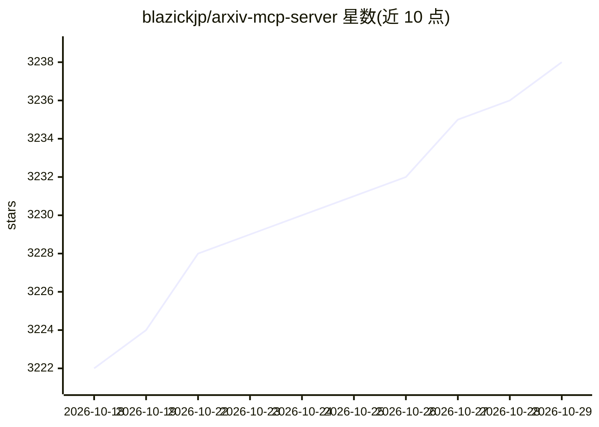

# blazickjp/arxiv-mcp-server

⭐ 3,238 · Python · Apache-2.0 · 推送 2026-10-08 · [GitHub](https://github.com/blazickjp/arxiv-mcp-server) · [官网](https://www.pulsemcp.com/servers/blazickjp-arxiv-mcp-server) · 个人维护

**本地 MCP 服务器：为 agent 提供 arXiv 文献阅读与引文工作流**

面向 agent 文献工作的本地 MCP 服务器，通过 stdio 运行，暴露 19 个工具：arXiv 检索、元数据/摘要获取、论文下载转 Markdown、本地分节阅读、作者提交的 LaTeX 分节读取、BibTeX 导出（基于 arXiv 官方元数据）、Semantic Scholar 引文图、以及本地保存的主题 watch 与新论文提醒。论文文件保存在本地磁盘（默认 ~/.arxiv-mcp-server/papers），检索与下载调用外部 arXiv API，读取默认以 12,000 字符为界。默认安装为 uvx arxiv-mcp-server（PyPI 发布，0.8.2），支持 Claude Code、Codex、Hermes、VS Code/Kiro 等客户端，并提供 Claude Code/Codex 插件与 Claude Desktop 的 .mcpb 打包（macOS，需 CPython 3.11）。

## 筛选速览

| 维度 | 判定 | 备注 |
|---|---|---|
| AI 角色 | `ai-ecosystem` | LLM/agent 周边工具 |
| 许可风险 | `permissive` | Apache-2.0 |
| 部署形态 | `library` | 以包/库形式分发 |
| 模型依赖 | locked-api |  |
| 硬件要求 | — | 无带数字的原话,不猜 |
| 安装摩擦 | `low` | 无编译、无系统依赖或容器化 |
| 成熟度 | — | 结构信号不足 |

## 能力要点

- 19 个工具覆盖 arXiv 检索、下载、分节阅读、LaTeX 分节读取
- 基于权威 arXiv 元数据导出 BibTeX
- 本地持久化主题 watch 与新论文检查（check_alerts）
- 读取默认 12,000 字符边界，semantic_search/reindex 需 [pro]

## 适用场景

- 让 Claude/Codex 等 agent 客户端直接检索和精读 arXiv 论文
- 论文 ID → 大纲 → 单节 → 引文的文献工作流
- 跟踪特定 arXiv 主题的新论文提醒
- 为本地论文库生成 BibTeX 引文

## 场景标签

`科研工具` · 领域:学习与行业

## 证据(README 行号)

> L17: A local MCP server for agent literature work. The differentiator is original-LaTeX section reads, BibTeX from arXiv
> L21: The default install is `uvx arxiv-mcp-server`. Command-based integrations need uv, which provides `uvx`. No reposit
> L172: The server currently exposes 19 tools.

## 星数曲线

2026-10-18 3,222 → 2026-10-29 3,238（+16）

---
*卡片 v1 · prompt 1.4 · 生成 2026-10-20 · 置信度 mid · 依据 README sha `d626e86a3a9e` · [字段定义](../../DATASET.md)*
