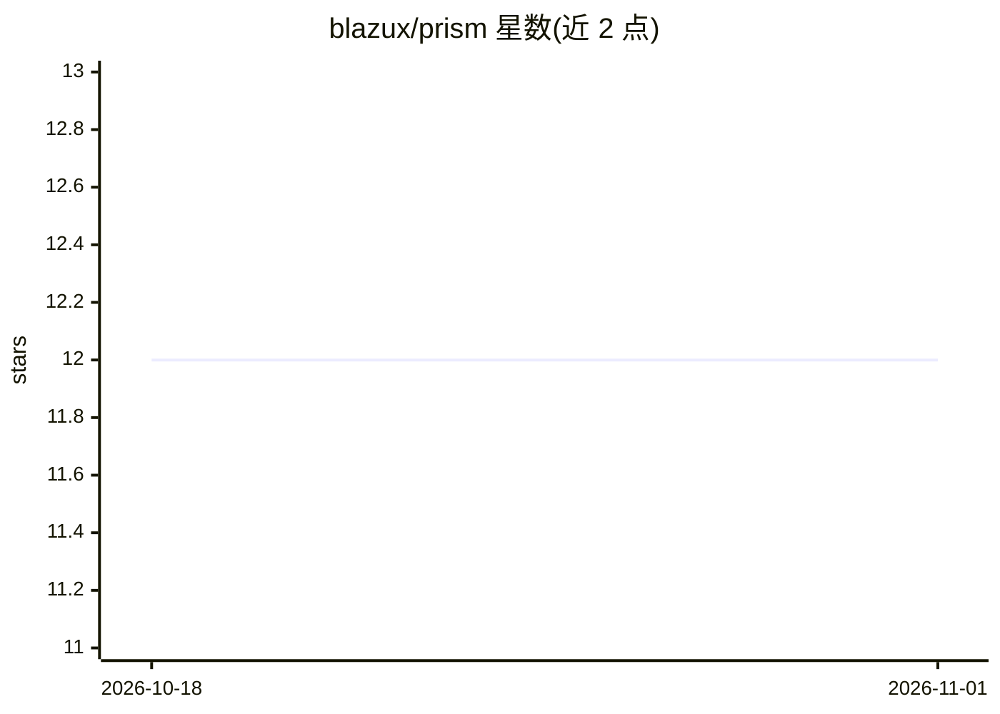

# blazux/prism

⭐ 12 · Go · MIT · 推送 2026-10-31 · [GitHub](https://github.com/blazux/prism) · 个人维护

**自托管的自主 AI agent 仪表盘：本地/云端模型驱动个人助理**

基于 Go 后端与原生 JS 前端的自托管 AI agent 平台，通过 Docker Compose 部署，支持 Ollama、OpenAI 兼容服务器（vLLM/SGLang/llama.cpp）或 Claude 作为模型后端。agent 在沙箱工作区运行代码、构建仪表盘小部件、按需启动 Docker 容器服务（Jupyter/Grafana 等）、连接 MCP 服务器、定义新工具，并集成邮件、日历、笔记、Telegram/Slack/Webex 等个人应用；支持 RAG 文档检索（pgvector）、webhook 触发与单用户/多用户两种模式。仅要求 Docker + Docker Compose 作为宿主依赖。

## 筛选速览

| 维度 | 判定 | 备注 |
|---|---|---|
| AI 角色 | `ai-native` | 本体是模型或模型工具 |
| 许可风险 | `permissive` | MIT |
| 部署形态 | `self-host` | docker 或自建部署 |
| 模型依赖 | local-ok | 支持本地模型 |
| 硬件要求 | — | 无带数字的原话,不猜 |
| 安装摩擦 | `low` | 无编译、无系统依赖或容器化 |
| 成熟度 | — | 结构信号不足 |

## 能力要点

- agent 可在沙箱工作区运行代码、构建小部件并自定义新工具
- 按需启动 Docker 容器服务并经 Traefik 以 *.localhost 子域嵌入仪表盘
- 接入 Ollama/OpenAI 兼容服务器/Claude 等多种模型来源与嵌入模型
- 邮件、日历、笔记（Obsidian/Logseq）、Telegram/Slack/Webex 集成与 webhook 触发

## 适用场景

- 在自有硬件上运行一个可操作邮件、日历、笔记的个人 AI 助理
- 通过对话让 agent 按需启动并管理 Jupyter、Grafana 等容器服务
- 用 webhook 让 Grafana 告警、CI 事件等自动触发 agent 处理
- 小团队/实验室以多用户模式共享一个 agent 平台

## 场景标签

`AI 助手` `RAG` `工作流自动化` · 领域:效率与自动化

## 证据(README 行号)

> L9: Yes, another AI dashboard. Except this one runs on your own hardware, with local models or the AI providers you choo
> L23: PRISM is built around a different premise: the agent has actual agency over its environment. It runs code in a sand
> L73: 1. Select a source or click **+ Add a source**. Choose **OpenAI**, **Anthropic**, **Ollama** or **Other compatible*

## 星数曲线

2026-10-18 12 → 2026-11-01 12（+0）

---
*卡片 v1 · prompt 1.4 · 生成 2026-11-01 · 置信度 high · 依据 README sha `f2165ac1d89a` · [字段定义](../../DATASET.md)*
