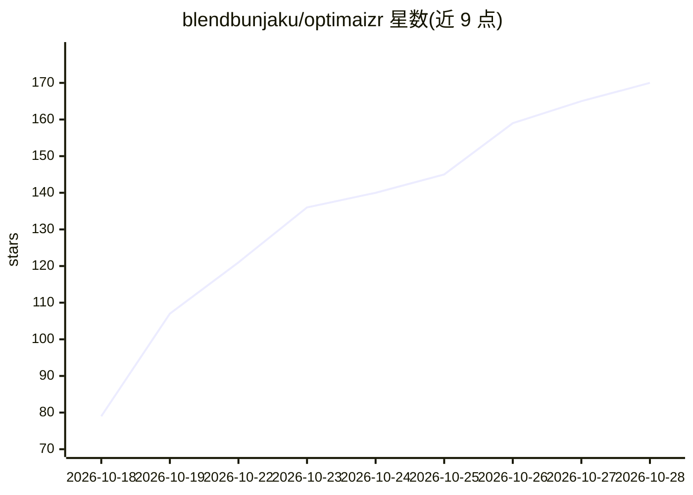

# blendbunjaku/optimaizr

⭐ 170 · TypeScript · MIT · 推送 2026-10-25 · [GitHub](https://github.com/blendbunjaku/optimaizr) · [官网](https://optimaizr.com) · 个人维护

**本地 CLI：分析并削减 Claude Code/Codex/opencode 的 token 开销**

读取本机已有的日志中的 token 计数（不读取提示词与回答内容），展示 token 去向、最贵的会话、缓存过期重写等开销，并给出以美元计价的节省估算。提供 guard 钩子（在发送高成本消息前拦截一次）、statusline 缓存倒计时、live 实时开销监控、apply/undo 一键修复（如更早压缩上下文）与 results 效果对比。兼容 Claude Code、Codex、opencode 1.x，可通过 optimaizr.wrap(new Anthropic()/new OpenAI()) 接入自有应用。需要 Node 20.11+（opencode 需 22.13+），opencode 2.0 历史暂不可读。

## 筛选速览

| 维度 | 判定 | 备注 |
|---|---|---|
| AI 角色 | `ai-ecosystem` | LLM/agent 周边工具 |
| 许可风险 | `permissive` | MIT |
| 部署形态 | `library` | 以包/库形式分发 |
| 模型依赖 | locked-api |  |
| 硬件要求 | — | 无带数字的原话,不猜 |
| 安装摩擦 | `low` | 无编译、无系统依赖或容器化 |
| 成熟度 | — | 结构信号不足 |

## 能力要点

- 从本机日志读取 token 计数，无账号、无上传、无遥测
- guard 拦截将触发过期缓存全量重写的消息并显示价格
- live 实时显示每轮成本、缓存剩余时间与 5 小时窗口占用
- apply/undo 一键修复（如 context-compaction），results 用自身用量验证效果

## 适用场景

- 查明长会话中缓存过期重写带来的 token 开销
- 在发送昂贵消息前获得价格提醒并选择 /clear 或换模型
- 验证上下文压缩等优化措施的实际节省效果

## 场景标签

`LLM 可观测性` · 领域:评测与运维

## 证据(README 行号)

> L25: No account, no upload, no telemetry. It reads token counts from the logs already
> L169: with one line, `optimaizr.wrap(new Anthropic())` or `new OpenAI()`, and CSV or

## 星数曲线

2026-10-18 79 → 2026-10-28 170（+91）

---
*卡片 v1 · prompt 1.4 · 生成 2026-10-23 · 置信度 high · 依据 README sha `de9fc5b10dcd` · [字段定义](../../DATASET.md)*
