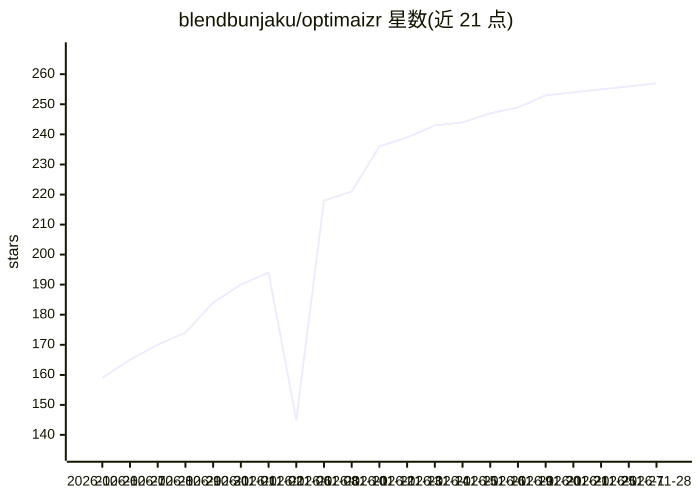

# blendbunjaku/optimaizr

⭐ 257 · TypeScript · MIT · 推送 2026-11-23 · [GitHub](https://github.com/blendbunjaku/optimaizr) · [官网](https://optimaizr.com) · 个人维护

**本地 CLI：分析 Claude Code 等 agent 会话的 token 浪费并省钱**

读取本机已有的 agent 日志（~/.claude、~/.codex、opencode 数据库），统计 token 去向与花费，定位缓存过期重写、上下文膨胀等高成本时刻；提供 guard 拦截昂贵消息、statusline 缓存倒计时、live 监视、sessions 排序、apply/undo 一键应用与回退修复、results 前后对比等功能。全部本地运行，默认不读取提示词与回答内容。以 npm CLI 分发，另提供 VS Code 扩展与 Claude Code 插件（mod）形态，要求 Node 20.11+。

## 筛选速览

| 维度 | 判定 | 备注 |
|---|---|---|
| AI 角色 | `ai-ecosystem` | LLM/agent 周边工具 |
| 许可风险 | `permissive` | MIT |
| 部署形态 | `library` | 以包/库形式分发 |
| 模型依赖 | — | README 未给出锁定关系 |
| 硬件要求 | — | 无带数字的原话,不猜 |
| 安装摩擦 | `low` | 无编译、无系统依赖或容器化 |
| 成熟度 | — | 结构信号不足 |

## 能力要点

- 读取本机 agent 日志做 token/成本分析，无需上传数据
- guard 在缓存过期时先拦下昂贵消息并标注代价
- optimaizr apply/undo/verify/results 形成修复-验证闭环
- 提供 CLI、VS Code 扩展、Claude Code 插件三种形态

## 适用场景

- 统计我长期 agent 会话里 token 花在哪、能省多少
- 在缓存过期前收到提醒，避免整段对话重写计费
- 应用压缩等修复后用 results 验证是否真的省钱
- 导出 30 天成本卡片分享对比

## 场景标签

 · 领域:LLM 基础设施/成本监控

## 证据(README 行号)

> L26: **Runs locally: nothing leaves your machine.** No account, no upload, no
> L177: |`optimaizr`|Where your tokens go, and what to fix first|
> L192: Claude Code, Codex and opencode 1.x with no setup. opencode history is read

## 星数曲线

2026-10-26 159 → 2026-11-28 257（+98）

---
*卡片 v1 · prompt 1.4 · 生成 2026-11-25 · 置信度 high · 依据 README sha `b127761812e1` · [字段定义](../../DATASET.md)*
