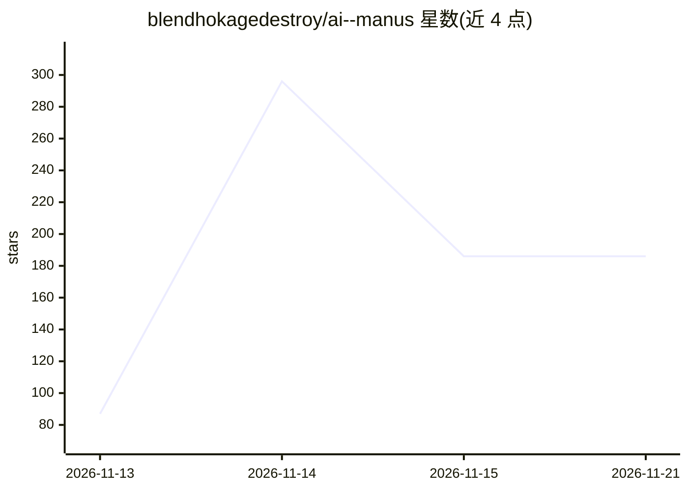

# blendhokagedestroy/ai--manus

⭐ 186 · Apache-2.0 · 推送 2026-11-15 · [GitHub](https://github.com/blendhokagedestroy/ai--manus) · 个人维护

**面向个人用户的自主 AI Agent：代跑代码与控制浏览器完成日常任务**

Manus 是一个自主 AI Agent，定位为家庭、学习与轻量办公场景的个人助手：用户以自然语言下达指令，代理自行编写并执行脚本、打开网页、填写表单、执行多步骤任务，代码执行与浏览器操作可在同一流程中衔接，支持会话间记住工作流模式。README 给出最低与推荐硬件配置（双核 CPU / 4GB 内存，推荐多核 / 8GB）与分步上手流程，但未提供具体的安装命令、模型接入方式或代码仓库运行说明，安装途径仅出现『Download Manus』与促销码字样。

## 筛选速览

| 维度 | 判定 | 备注 |
|---|---|---|
| AI 角色 | `ai-native` | 本体是模型或模型工具 |
| 许可风险 | `permissive` | Apache-2.0 |
| 部署形态 | `None` |  |
| 模型依赖 | — | README 未给出锁定关系 |
| 硬件要求 | — | 无带数字的原话,不猜 |
| 安装摩擦 | `low` | 无编译、无系统依赖或容器化 |
| 成熟度 | — | 结构信号不足 |

## 能力要点

- 自主代码执行：代理自行编写并运行脚本完成任务
- 浏览器控制：导航网页、填表、跨页面收集信息
- 代码与浏览器操作在同一工作流中衔接，跨会话复用任务模式
- 声明面向小规模场景（家庭/学习/轻办公），非企业平台

## 适用场景

- 让代理代为检索网页信息并汇总成小报告
- 自动执行重复性的小型脚本与文件整理任务
- 学习场景下整理研究笔记、跑快速计算

## 场景标签

`AI 助手` `浏览器自动化` `编码 Agent` · 领域:效率与自动化

## 证据(README 行号)

> L18: Manus is an autonomous AI agent designed to run code and control a browser on your behalf. Instead of acting like a
> L22: Manus is not a heavy studio suite or a complex enterprise platform. It is a focused helper built for home, study, a

## 星数曲线

2026-11-13 87 → 2026-11-21 186（+99）

---
*卡片 v1 · prompt 1.4 · 生成 2026-11-17 · 置信度 mid · 依据 README sha `0f78ee3a5dd2` · [字段定义](../../DATASET.md)*
