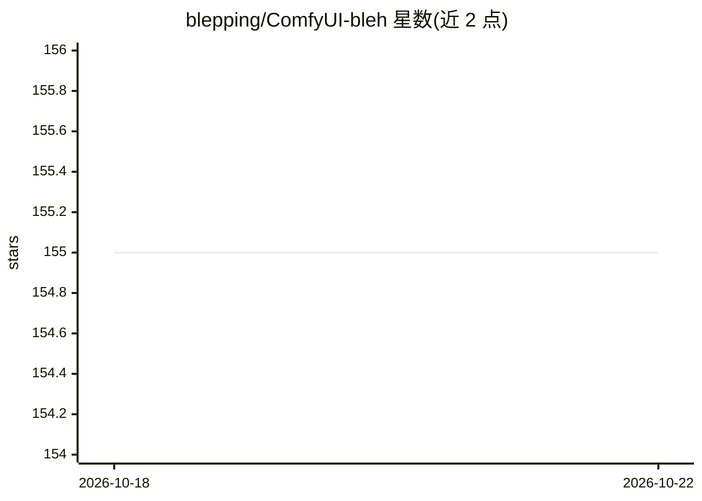

# blepping/ComfyUI-bleh

⭐ 155 · Python · Apache-2.0 · 推送 2026-09-16 · [GitHub](https://github.com/blepping/ComfyUI-bleh) · 个人维护

**ComfyUI 节点集：改进 TAESD 预览与模型 patch 功能**

面向 ComfyUI 用户的实用工具与模型 patch 节点合集：提供批量/网格/动画形式的增强 TAESD 预览，覆盖音频模型（ACE-Step、MiniMax Music3、YuE2）与多帧视频模型（Wan、Hunyuan、LTX 等）预览；并扩展 HyperTile（可设种子与时间步范围）、Deep Shrink（多 block 应用与渐出）、条件化模型 patch、SageAttention 包装等采样控制节点。通过复制示例 YAML 文件配置，重启 ComfyUI 生效。部分节点标注为实验性或未充分测试。

## 筛选速览

| 维度 | 判定 | 备注 |
|---|---|---|
| AI 角色 | `ai-ecosystem` | LLM/agent 周边工具 |
| 许可风险 | `permissive` | Apache-2.0 |
| 部署形态 | `None` |  |
| 模型依赖 | — | README 未给出锁定关系 |
| 硬件要求 | — | 无带数字的原话,不猜 |
| 安装摩擦 | `medium` | 含编译或系统依赖之一 |
| 成熟度 | `idea` | |

## 能力要点

- 批量/网格/动画 TAESD 预览，支持音频与多帧视频模型
- HyperTile 可设种子、时间步范围与步间隔
- 条件化模型 patch（按间隔或采样百分比应用）
- SageAttention 全局启用或采样器包装两种方式

## 适用场景

- 生成过程中预览整批或视频帧的中间结果
- 在指定时间步区间应用 HyperTile 等模型 patch
- 通过外部端点网页查看最近一次预览

## 场景标签

`图像生成` · 领域:内容生成

## 证据(README 行号)

> L3: A ComfyUI nodes collection of utility and model patching functions. Also includes improved previewer that allows pre
> L9: * Better TAESD previews (see below).

## 星数曲线

2026-10-18 155 → 2026-10-22 155（+0）

---
*卡片 v1 · prompt 1.4 · 生成 2026-10-22 · 置信度 high · 依据 README sha `daa14f75fc75` · [字段定义](../../DATASET.md)*
