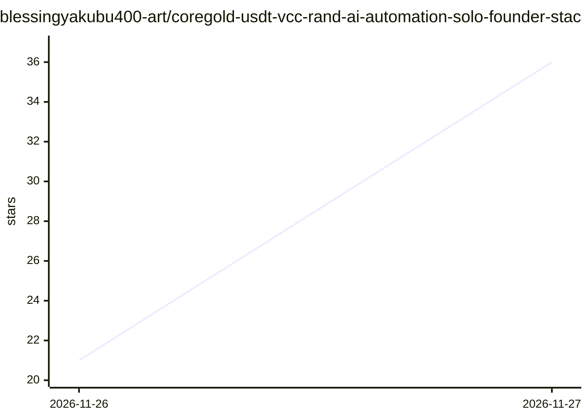

# blessingyakubu400-art/coregold-usdt-vcc-rand-ai-automation-solo-founder-stack-guide

⭐ 36 · 推送 2026-11-24 · [GitHub](https://github.com/blessingyakubu400-art/coregold-usdt-vcc-rand-ai-automation-solo-founder-stack-guide) · [官网](https://app.coregold.io/signup?invite_code=ADvlj9b) · 个人维护 · 中文 README

**面向一人公司的虚拟卡开通与订阅支付操作教程**

以 RAND 关于 AI 自动化的讨论为引子撰写的操作指南：介绍超级个体/自由职业者通过注册 CoreGold 平台、以 USDT（TRC20）充值钱包、选择卡套餐与 BIN、自动生成北美账单地址，并将虚拟卡绑定 Apple Pay / Google Pay 的分步流程。内容包含注册链接（带邀请码）、充值步骤、卡冻结与余额管理等操作说明。README 不涉及任何代码、安装命令或可运行的软件，性质为一篇带推广链接的教程文章。

## 筛选速览

| 维度 | 判定 | 备注 |
|---|---|---|
| AI 角色 | `ai-knowledge` | 知识聚合/清单类 |
| 许可风险 | `none` | — |
| 部署形态 | `None` |  |
| 模型依赖 | — | README 未给出锁定关系 |
| 硬件要求 | — | 无带数字的原话,不猜 |
| 安装摩擦 | `low` | 无编译、无系统依赖或容器化 |
| 成熟度 | — | 结构信号不足 |

## 能力要点

- USDT（TRC20）网络充值 CoreGold 钱包的开卡流程
- 长期订阅卡与临时测试卡分开管理的用卡法则
- 绑定 Apple Pay / Google Pay 的分步操作与邮箱验证码获取方式
- 开卡时自动生成北美 AVS 账单地址

## 适用场景

- 独立开发者订阅海外 AI 会员与生产力软件时的支付配置
- 自由职业者需要用虚拟卡购买海外域名、主机与内购工具
- 新手不了解美国账单地址格式时的开卡操作参考

## 场景标签

`教程课程` · 领域:学习与行业

## 证据(README 行号)

> L9: ### 🔍 核心干货：超级个体与一人公司的 4 个极简用卡法则
> L22: ### 🧭 CoreGold 极简开卡与绑定教程（一看就会）

## 星数曲线

2026-11-26 21 → 2026-11-27 36（+15）

---
*卡片 v1 · prompt 1.4 · 生成 2026-11-26 · 置信度 high · 依据 README sha `cfbaa0eb6ae8` · [字段定义](../../DATASET.md)*
