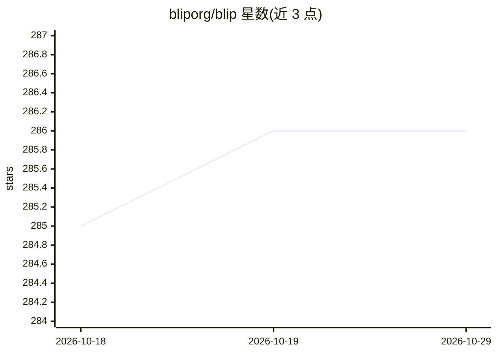

# bliporg/blip

⭐ 286 · Go · Apache-2.0 · 推送 2026-03-09 · [GitHub](https://github.com/bliporg/blip) · [官网](https://blip.game) · 组织维护

**面向生成式 AI 的 Roblox 类跨平台游戏引擎与分发平台**

Blip 是一个类似 Roblox 的游戏创作与分发平台，定位服务生成式 AI 时代的广大创作者群体，支持在移动端创作游戏。创作者可通过自然语言构建游戏逻辑，也可直接编写和修改代码；体验使用 Luau 脚本语言编写，支持客户端与服务器端脚本及实时多人游戏的免费可扩展服务器基础设施。引擎为自研 C/C++，使用 BGFX 做跨平台渲染，原生编译各平台并通过 WebAssembly 支持 Web 浏览器与 Discord。README 声明当前为进行中状态，构建尚未可用。

## 筛选速览

| 维度 | 判定 | 备注 |
|---|---|---|
| AI 角色 | `ai-enhanced` | 去掉 AI 部分产品仍成立 |
| 许可风险 | `permissive` | Apache-2.0 |
| 部署形态 | `None` |  |
| 模型依赖 | — | README 未给出锁定关系 |
| 硬件要求 | — | 无带数字的原话,不猜 |
| 安装摩擦 | `low` | 无编译、无系统依赖或容器化 |
| 成熟度 | `idea` | |

## 能力要点

- 自然语言构建游戏逻辑，同时保留直接编写代码的能力
- 单应用跨平台：iOS/iPadOS、Android、Windows、macOS、浏览器与 Discord
- Luau 脚本编写客户端/服务器逻辑，含免费可扩展多人游戏服务器
- C/C++ 自研引擎，BGFX 渲染，WebAssembly 支持 Web 平台

## 适用场景

- 用自然语言或代码创作游戏并在移动端完成开发
- 构建带实时多人联机的脚本化游戏体验
- 通过 GitHub 开源模块扩展游戏功能

## 场景标签

`代码生成` · 领域:编码与开发

## 证据(README 行号)

> L11: Blip is a Roblox-like platform tailored for generative AI, empowering a wide audience of creators to make games. It
> L15: While you can build game logic through natural language, developers still have full access to write and modify code

## 星数曲线

2026-10-18 285 → 2026-10-29 286（+1）

---
*卡片 v1 · prompt 1.4 · 生成 2026-10-22 · 置信度 mid · 依据 README sha `c842da606c4a` · [字段定义](../../DATASET.md)*
