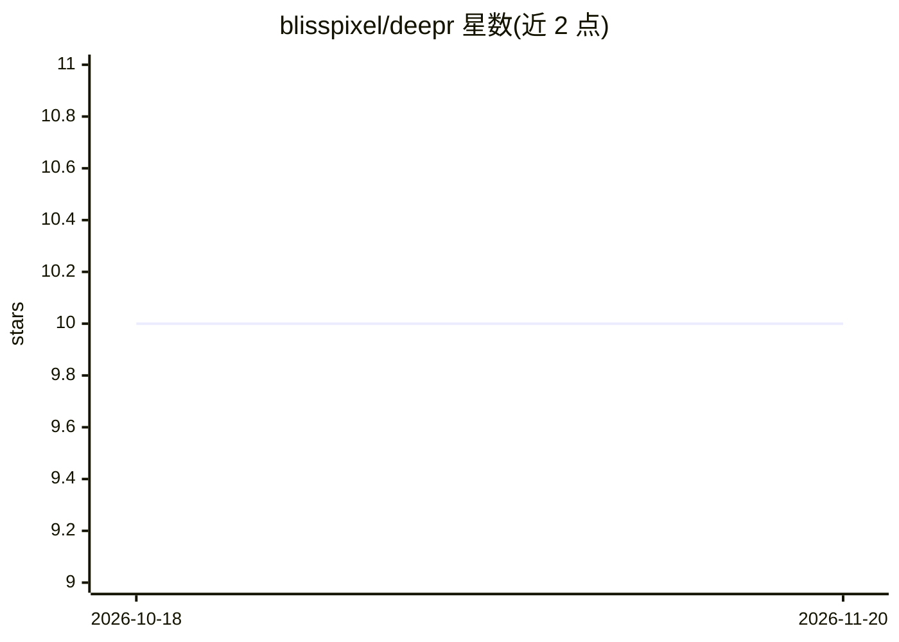

# blisspixel/deepr

⭐ 10 · Python · Apache-2.0 · 推送 2026-11-18 · [GitHub](https://github.com/blisspixel/deepr) · 个人维护

**从有界可审计研究构建持久领域专家的 CLI 工具**

Deepr 通过保留研究、概念、立场、推理与时间关系，构建可检视的持久领域专家状态，供用户和 agent 团队通过 CLI 或 MCP 反复咨询，可查看哪些内容发生了变化、立场依据及未知之处。关键机制包括费用护栏（默认 $5 fail-closed 上限、钱包积分、需显式授权）、容量分层（优先本地模型，其次订阅额度，无自动付费 API 回退），以及来源归属与修订说明的开发标准。集成式持久 agent 会话与默认咨询前准备仍在路线图中。

## 筛选速览

| 维度 | 判定 | 备注 |
|---|---|---|
| AI 角色 | `ai-native` | 本体是模型或模型工具 |
| 许可风险 | `permissive` | Apache-2.0 |
| 部署形态 | `library` | 以包/库形式分发 |
| 模型依赖 | local-ok | 支持本地模型 |
| 硬件要求 | — | 无带数字的原话,不猜 |
| 安装摩擦 | `low` | 无编译、无系统依赖或容器化 |
| 成熟度 | `idea` | |

## 能力要点

- 持久专家状态：立场、研究、来源计数与立场变化记录可检视
- 费用护栏：默认 $5 fail-closed 上限，上限提升需操作者显式设置
- 容量分层：优先本地 Ollama，OpenRouter 付费路径需钱包与授权门控
- CLI 与 MCP 两种咨询接口

## 适用场景

- 在持续变化的领域反复咨询同一个可检视的专家状态
- 为 agent 团队提供带费用上限的领域顾问
- 跟踪领域知识随时间的变化与立场修订

## 场景标签

`知识图谱` `知识库管理` `科研工具` · 领域:知识与检索

## 证据(README 行号)

> L15: Deepr is for people and agent teams making recurring decisions in domains that
> L17: same inspectable expert state through the CLI or MCP and can see what changed,
> L34: **The product target is a persistent domain agent.** An expert should be a

## 星数曲线

2026-10-18 10 → 2026-11-20 10（+0）

---
*卡片 v1 · prompt 1.4 · 生成 2026-11-19 · 置信度 mid · 依据 README sha `0ab4214ccd4d` · [字段定义](../../DATASET.md)*
