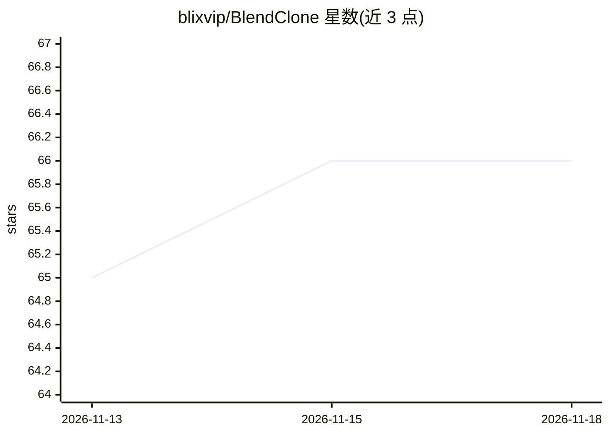

# blixvip/BlendClone

⭐ 66 · Python · MIT · 推送 2026-11-17 · [GitHub](https://github.com/blixvip/BlendClone) · [官网](https://discord.gg/grokbot) · 个人维护

**把参考视频转换为可编辑 Blender 工程的 AI 重建应用**

本地 FastAPI 应用：导入视频片段（链接或本地文件），由 AI 规划器（经 Codex CLI 调用 ChatGPT 账号、默认 gpt-6-astra）分析几何、材质、相机、灯光与动画，生成经 Pydantic 校验的场景 JSON，再由仓库自有的确定性编译器转为原生 Blender 对象，输出逐帧保真度评分（SSIM/ΔE/光流）、双画面对比与可编辑 .blend。README 明确声明为实验性重建工具，不支持骨骼绑定、物理与图像纹理。

## 筛选速览

| 维度 | 判定 | 备注 |
|---|---|---|
| AI 角色 | `ai-native` | 本体是模型或模型工具 |
| 许可风险 | `permissive` | MIT |
| 部署形态 | `desktop` | 安装包/桌面程序 |
| 模型依赖 | — | README 未给出锁定关系 |
| 硬件要求 | — | 无带数字的原话,不猜 |
| 安装摩擦 | `medium` | 含编译或系统依赖之一 |
| 成熟度 | `idea` | |

## 能力要点

- 场景 JSON → 原生 Blender 对象的确定性编译，模型输出数据而非代码
- 同步参考/重制对比播放器与逐帧保真度评分（SSIM、ΔE、光流、时延）
- 英文自然语言修正循环（Refine）与可编辑 .blend/工程 ZIP 导出
- 仅执行仓库自有的 Blender Python，模型写入的代码不运行

## 适用场景

- 把实拍或参考视频重建为可在 Blender 中继续编辑的 3D 场景
- 对比参考与重制画面并按逐帧保真评分迭代修正
- 从场景 JSON 批量重建展示场景用于演示

## 场景标签

 · 领域:3D 重建/创作工具

## 证据(README 行号)

> L5: Import a clip, let an AI planner describe the scene, compile it into native Blender objects,
> L28: |**Analyse**|Samples timestamped frames (extra samples around big visual changes) and asks the planner model for ge
> L79: - **Planner**: the official Codex CLI with your ChatGPT login (`BLENDREMAKE_MODEL`, default `gpt-6-astra`). No API 

## 星数曲线

2026-11-13 65 → 2026-11-18 66（+1）

---
*卡片 v1 · prompt 1.4 · 生成 2026-11-18 · 置信度 mid · 依据 README sha `90c75c500906` · [字段定义](../../DATASET.md)*
