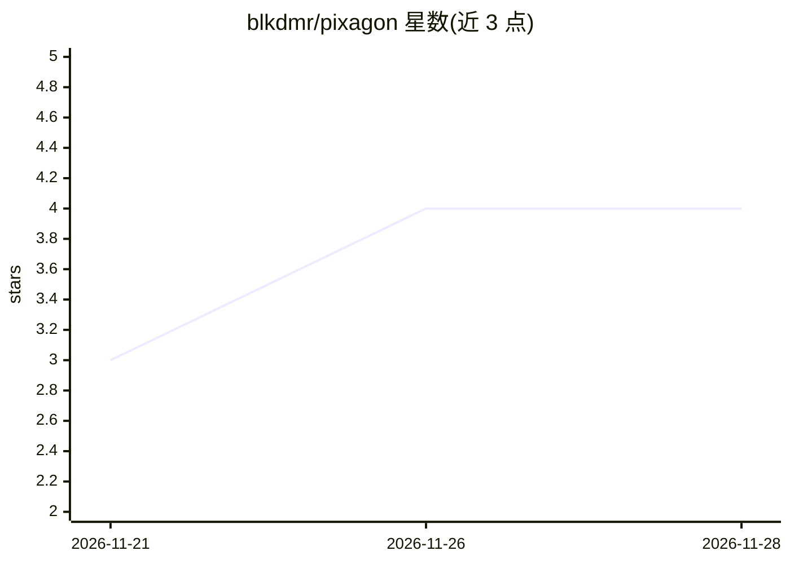

# blkdmr/pixagon

⭐ 4 · Python · Apache-2.0 · 推送 2026-11-19 · [GitHub](https://github.com/blkdmr/pixagon) · [官网](https://blkdmr.github.io/pixagon/) · 个人维护

**Aseprite 像素画 AI 助手：本地或云端生成、编辑、补绘 sprite**

以 Aseprite 扩展形式运行的像素画 AI 助手，提供四种功能：文本生成 sprite、按指令编辑、仅处理选中区域的 inpaint、Rotate + Instruct 多视角生成。输出经像素画后处理（调色板量化、背景移除、镜像对称、适配画布）。运行方式二选一：本地 GPU 跑 FLUX.2 Klein 4B 模型（NVIDIA 12+ GB VRAM 或 Apple Silicon），或通过 OpenRouter 调云端图像模型（默认 google/gemini-2.5-flash-image）。结果以新图层放入 sprite，不改动原有像素。安装只需双击扩展文件，Setup 自动装 uv 与 Python 环境。

## 筛选速览

| 维度 | 判定 | 备注 |
|---|---|---|
| AI 角色 | `ai-native` | 本体是模型或模型工具 |
| 许可风险 | `permissive` | Apache-2.0 |
| 部署形态 | `None` |  |
| 模型依赖 | locked-api |  |
| 硬件要求 | — | 无带数字的原话,不猜 |
| 安装摩擦 | `medium` | 含编译或系统依赖之一 |
| 成熟度 | `idea` | |

## 能力要点

- 文本生成、指令编辑、选区 inpaint、多视角生成四种任务
- 本地运行 FLUX.2 Klein 4B，数据不出本机
- OpenRouter 云端后端，无 GPU 也可用
- 像素画后处理：量化/去背景/镜像对称/适配画布

## 适用场景

- 在 Aseprite 里用文字描述直接生成游戏 sprite
- 按指令改色、发光等微调现有像素画
- 生成角色多角度视图（turnaround）
- 没有 GPU 时用云模型出图

## 场景标签

`图像生成` · 领域:内容生成

## 证据(README 行号)

> L3: Generate sprites from a text prompt, edit an existing sprite with a plain instruction, or redraw only a selected reg
> L32: **Local GPU (private, free to run).** Pixagon runs the FLUX.2 Klein 4B diffusion model on your own computer. Nothin
> L38: **OpenRouter (cloud, no GPU needed).** No NVIDIA GPU, no Apple Silicon Mac, or a card that is too weak? Use an Open

## 星数曲线

2026-11-21 3 → 2026-11-28 4（+1）

---
*卡片 v1 · prompt 1.4 · 生成 2026-11-22 · 置信度 high · 依据 README sha `254ae344c605` · [字段定义](../../DATASET.md)*
