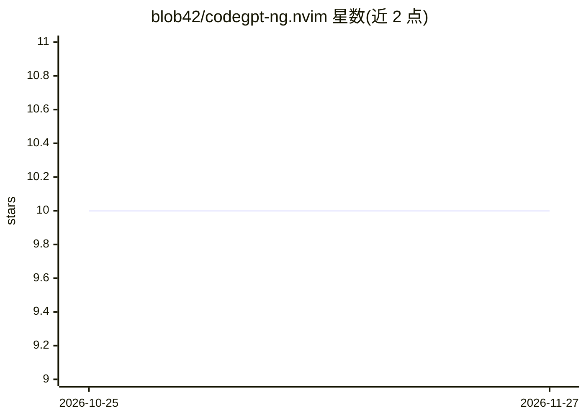

# blob42/codegpt-ng.nvim

⭐ 10 · Lua · AGPL-3.0 · 推送 2026-05-12 · [GitHub](https://github.com/blob42/codegpt-ng.nvim) · 个人维护

**Neovim 命令行式 LLM 代码辅助插件，支持 Ollama/OpenAI**

以 vimway 为原则的极简 Neovim 插件，通过 `:Chat` 顶层命令在 cmdline 模式与 LLM 后端交互，提供补全、代码编辑、解释、问答、调试、生成文档、优化、写单元测试、校对、聊天等内置命令；响应可流式输出并以弹窗或行操作（追加/前置/替换/插入）回填。支持 Lua 表定义自定义命令、模板宏、缓冲区与寄存器上下文注入、模型继承与别名配置，通过 Lazy/Packer 安装，依赖 plenary 与 nui 插件。

## 筛选速览

| 维度 | 判定 | 备注 |
|---|---|---|
| AI 角色 | `ai-native` | 本体是模型或模型工具 |
| 许可风险 | `viral` | AGPL-3.0 |
| 部署形态 | `None` |  |
| 模型依赖 | local-ok | 支持本地模型 |
| 硬件要求 | — | 无带数字的原话,不猜 |
| 安装摩擦 | `low` | 无编译、无系统依赖或容器化 |
| 成熟度 | — | 结构信号不足 |

## 能力要点

- :Chat 命令驱动 10 个内置命令（补全/解释/调试/文档/测试等）
- 命令后缀即时覆盖回调类型（追加/前置/替换/插入/弹窗）
- 缓冲区 #{bufnr} 与寄存器 ""x 动态注入提示上下文，模板宏递归展开
- 模型表支持继承、别名与交互式选择，兼容 llama-swap 路由预热

## 适用场景

- 在 Neovim 中对选中代码生成单元测试或文档
- 选中文本向 LLM 提问并将回答回填到缓冲区
- 配置自定义命令模板固化团队代码操作流程
- 本地 Ollama 模型接入编辑器完成代码辅助

## 场景标签

`代码生成` · 领域:编码与开发

## 证据(README 行号)

> L3: **Codegpt-ng** is a minimalistic Neovim plugin designed for efficient, command-line-driven workflows. Built with vim
> L57: The main way to call codegpt is through the top-level command `:Chat` (or its shortcut `:C`). Optionally followed b

## 星数曲线

2026-10-25 10 → 2026-11-27 10（+0）

---
*卡片 v1 · prompt 1.4 · 生成 2026-11-19 · 置信度 high · 依据 README sha `91bff4d3a623` · [字段定义](../../DATASET.md)*
