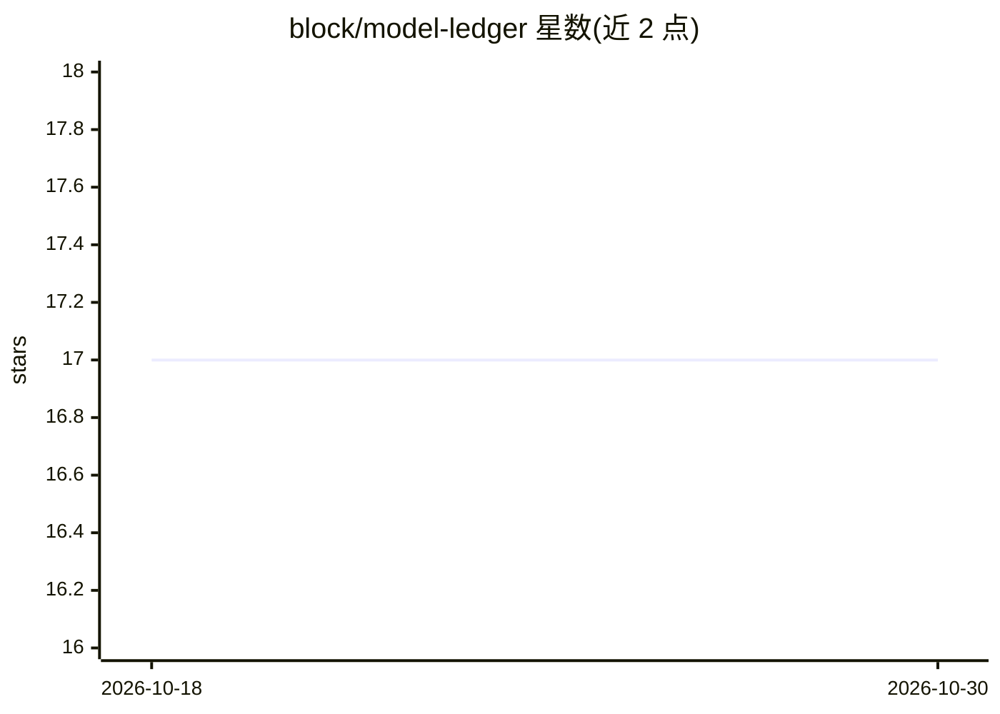

# block/model-ledger

⭐ 17 · Python · Apache-2.0 · 推送 2026-09-17 · [GitHub](https://github.com/block/model-ledger) · [官网](https://block.github.io/model-ledger/) · 组织维护

**组织级模型资产清单与治理账本：跨平台盘点模型并记录变更**

面向有已部署模型的组织，model-ledger 自动发现各平台上的模型、规则与 ETL 管道，构建依赖图，并将每次变更记录为不可变的 append-only 事件（Snapshot），支持时点重建。它不绑定单一平台（MLflow/SageMaker/W&B 之外跨平台聚合），并通过原生 MCP server 提供 8 工具的 agent 查询面，可接入 Claude 等 MCP agent。内置 SR 11-7/SR 26-2、EU AI Act Annex IV、NIST AI RMF 合规校验。以 Python 包形式 pip 安装，后端支持内存/SQLite/JSON/Snowflake/HTTP。

## 筛选速览

| 维度 | 判定 | 备注 |
|---|---|---|
| AI 角色 | `ai-ecosystem` | LLM/agent 周边工具 |
| 许可风险 | `permissive` | Apache-2.0 |
| 部署形态 | `library` | 以包/库形式分发 |
| 模型依赖 | — | README 未给出锁定关系 |
| 硬件要求 | — | 无带数字的原话,不猜 |
| 安装摩擦 | `low` | 无编译、无系统依赖或容器化 |
| 成熟度 | — | 结构信号不足 |

## 能力要点

- 跨平台自动发现模型、规则与 ETL 并构建依赖图
- append-only Snapshot 事件日志与时点重建
- 原生 MCP server（8 工具 agent 面）可由 Claude 等 agent 驱动
- 内置 SR 11-7/SR 26-2、EU AI Act Annex IV、NIST AI RMF 校验

## 适用场景

- 盘点全组织已部署模型及其依赖关系
- 评估弃用某个特征或模型时的影响范围
- 为监管合规保留模型变更的不可变审计轨迹
- 让 AI agent 以对话方式查询模型资产清单

## 场景标签

`MLOps` · 领域:训练与推理

## 证据(README 行号)

> L17: model-ledger is a model inventory for any organization with deployed models. It

## 星数曲线

2026-10-18 17 → 2026-10-30 17（+0）

---
*卡片 v1 · prompt 1.4 · 生成 2026-10-29 · 置信度 high · 依据 README sha `6bf0f2556165` · [字段定义](../../DATASET.md)*
