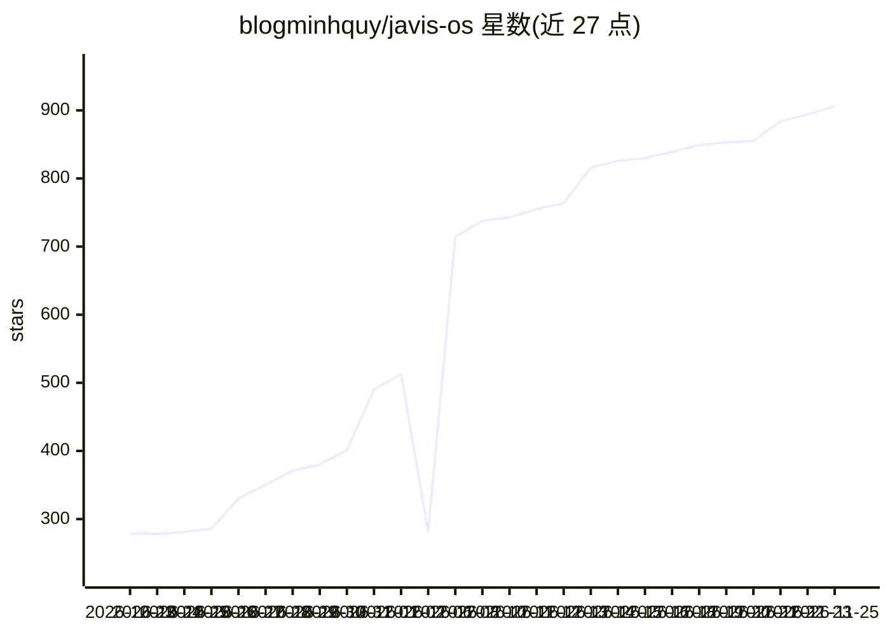

# blogminhquy/javis-os

⭐ 906 · Python · MIT · 推送 2026-11-24 · [GitHub](https://github.com/blogminhquy/javis-os) · [官网](https://javisos.com) · 个人维护

**自托管的 AI 团队编排系统：把多个模型当作可替换的大脑共管**

以 Python 3.12 与 Docker 部署、运行在自有机器或 VPS 的自托管 agentic AI 系统：通过订阅版 CLI（Claude Code、Codex、Grok Build、Antigravity）或 API 接入 14 个模型提供方，共享 MCP Hub、Skills、Second Brain（Markdown 记忆库 + 知识图谱）、Kanban 任务队列、定时 loops/reminders 与多 coworkers/团队机制。数据以 Markdown、SQLite、git commit 形式存于本地。README 警示用订阅套餐跑后台任务存在账号受限风险，建议改用 API key 或指定其他后台模型。

## 筛选速览

| 维度 | 判定 | 备注 |
|---|---|---|
| AI 角色 | `ai-ecosystem` | LLM/agent 周边工具 |
| 许可风险 | `permissive` | MIT |
| 部署形态 | `desktop` | 安装包/桌面程序 |
| 模型依赖 | local-ok | 支持本地模型 |
| 硬件要求 | — | 无带数字的原话,不猜 |
| 安装摩擦 | `low` | 无编译、无系统依赖或容器化 |
| 成熟度 | — | 结构信号不足 |

## 能力要点

- 14 个模型提供方可随时切换，共享同一套记忆、技能与 MCP 工具
- Second Brain 为 Obsidian 兼容 Markdown 库，学习过程以 git commit 记录、可一键回退
- 后台 Kanban 任务、loops/reminders、coworkers 角色与团队协作
- 语音交互与 Telegram/Slack/WhatsApp/Zalo 等多渠道接入

## 适用场景

- 在自有服务器上让多个 AI coworker 持续执行后台任务
- 更换模型时不迁移记忆与工作流，保持知识资产本地化
- 通过 WhatsApp/Telegram 等渠道向客户部署多渠道聊天机器人

## 场景标签

`聊天机器人` `知识库管理` `知识图谱` `Agent 框架` · 领域:Agent 开发

## 证据(README 行号)

> L57: Javis OS is **not** a chatbot. It is a **self-hosted agentic AI** that runs on your own machine or VPS: it reads an
> L111: Pick the brain on the **Models** page and change it whenever you like. Javis supports **14 providers** today.

## 星数曲线

2026-10-23 279 → 2026-11-25 906（+627）

---
*卡片 v1 · prompt 1.4 · 生成 2026-11-25 · 置信度 high · 依据 README sha `5909e7928412` · [字段定义](../../DATASET.md)*
