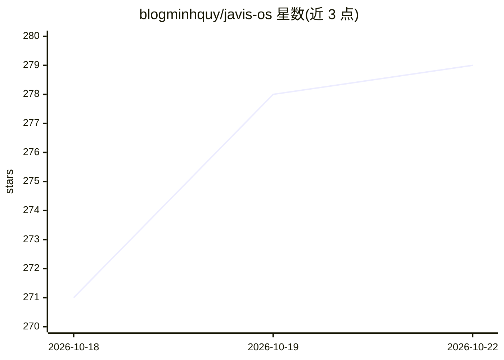

# blogminhquy/javis-os

⭐ 279 · Python · MIT · 推送 2026-10-21 · [GitHub](https://github.com/blogminhquy/javis-os) · [官网](https://javisos.com) · 个人维护 · 中文 README

**自托管语音 AI agent 系统：可换模型、带自我积累的第二大脑**

运行在笔记本或小型 VPS 上的自托管 agentic AI 系统：通过语音、Web 仪表盘、Telegram/Slack/WhatsApp/Zalo 或 CLI 交互，支持 14 个模型提供方（Claude Code、Codex、Grok、OpenRouter、Ollama 等）随时切换且工具不变。核心机制包括 Markdown/Obsidian 兼容的 Second Brain（每次学习通过 git commit 可撤销）、MCP 连接中心、后台任务队列/循环/提醒、代理与工作流。数据以纯文件形式留在本机。限制：订阅型 CLI 后台使用有账号封禁风险（README 明确警告）。后端为 Python FastAPI，提供一键安装脚本与 Docker 部署。

## 筛选速览

| 维度 | 判定 | 备注 |
|---|---|---|
| AI 角色 | `ai-native` | 本体是模型或模型工具 |
| 许可风险 | `permissive` | MIT |
| 部署形态 | `desktop` | 安装包/桌面程序 |
| 模型依赖 | local-ok | 支持本地模型 |
| 硬件要求 | — | 无带数字的原话,不猜 |
| 安装摩擦 | `low` | 无编译、无系统依赖或容器化 |
| 成熟度 | — | 结构信号不足 |

## 能力要点

- 14 个模型提供方可切换，同一工具集（MCP、技能、代理、工作流）
- Second Brain：Markdown 知识库 + 知识图谱，每次学习为 git commit 可撤销
- 后台工作：Kanban 任务队列、循环、提醒、多步工作流
- MCP 连接存储，多账号与三级权限

## 适用场景

- 在自己机器上运行长期记住我的 AI 助手，换模型不丢记忆
- 语音操控并让 AI 在后台排队执行任务、定时提醒
- 把积累的记忆、技能、工作流以纯文本形式保存和同步到私有 GitHub

## 场景标签

 · 领域:个人 AI 助手/agent 系统

## 证据(README 行号)

> L55: Javis OS is **not** a chatbot. It is a **self-hosted agentic AI** that runs on your own machine or VPS: it reads an
> L109: Pick the brain on the **Models** page and change it whenever you like. Javis supports **14 providers** today.
> L121: |**Ollama Cloud** · **Ollama on this machine**|API key, or free on your own hardware|via Javis tools|

## 星数曲线

2026-10-18 271 → 2026-10-22 279（+8）

---
*卡片 v1 · prompt 1.4 · 生成 2026-10-22 · 置信度 high · 依据 README sha `962ee1105176` · [字段定义](../../DATASET.md)*
