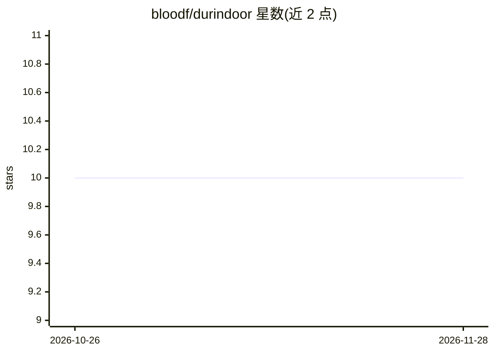

# bloodf/durindoor

⭐ 10 · JavaScript · MIT · 推送 2026-11-27 · [GitHub](https://github.com/bloodf/durindoor) · [官网](https://www.durindoor.app/) · 个人维护

**自托管 AI 网关：统一接入多家提供商订阅、API key 与本地模型**

以 Node.js 运行的自托管网关，将 AI 客户端请求转发到提供商订阅、API key、OAuth 账户或本地模型，兼容 OpenAI Chat Completions/Responses 与 Anthropic Messages 两种请求格式并做格式转换。支持 model 别名与按序回退的 combo、账户额度冷却回退、用量监控与脱敏代理时间线；内置仪表盘管理连接与 key，默认 SQLite 存储、可选 Postgres，支持 Docker 部署。是 9router 的 fork，MIT 许可。

## 筛选速览

| 维度 | 判定 | 备注 |
|---|---|---|
| AI 角色 | `ai-ecosystem` | LLM/agent 周边工具 |
| 许可风险 | `permissive` | MIT |
| 部署形态 | `self-host` | docker 或自建部署 |
| 模型依赖 | local-ok | 支持本地模型 |
| 硬件要求 | — | 无带数字的原话,不猜 |
| 安装摩擦 | `low` | 无编译、无系统依赖或容器化 |
| 成熟度 | — | 结构信号不足 |

## 能力要点

- 提供 OpenAI 与 Anthropic 兼容 API（/v1/chat/completions、/v1/responses、/v1/messages）
- OAuth 账户、API key、浏览器 cookies 及兼容端点多类连接方式
- combo 按配置顺序回退，账户级额度冷却与配额感知切换
- 内置仪表盘与 MCP 网关（带作用域 key），支持图像/语音/嵌入/搜索等端点

## 适用场景

- 让 Claude Code、Codex、Cursor 等客户端通过统一网关访问多家提供商
- 配置订阅→付费 API→本地模型的回退顺序以应对额度限制
- 自托管环境聚合个人 API key 与 Ollama 等本地模型
- 用仪表盘查看请求用量并按需启用脱敏代理时间线

## 场景标签

`模型网关` · 领域:Agent 开发

## 证据(README 行号)

> L21: DurinDoor connects your AI clients to provider subscriptions, API keys, and local models. Send OpenAI chat completi
> L97: |Client format|Route|
> L133: |Provider API keys|OpenAI, Anthropic, Gemini, OpenRouter, DeepSeek|

## 星数曲线

2026-10-26 10 → 2026-11-28 10（+0）

---
*卡片 v1 · prompt 1.4 · 生成 2026-11-19 · 置信度 high · 依据 README sha `a06968fb2f35` · [字段定义](../../DATASET.md)*
