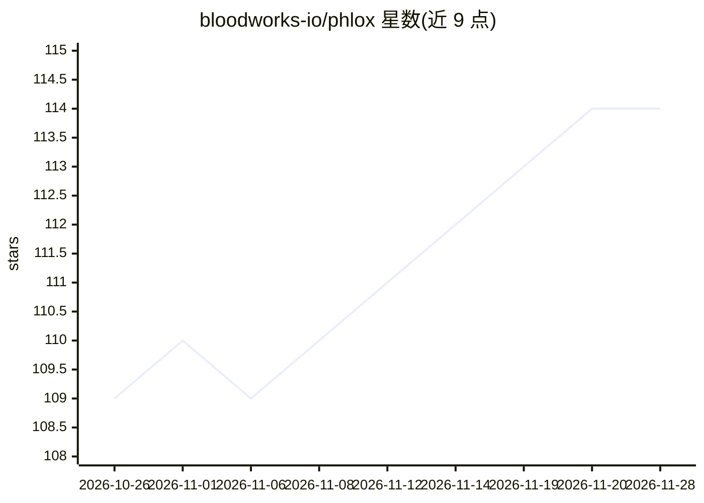

# bloodworks-io/phlox

⭐ 114 · JavaScript · MIT · 推送 2026-11-23 · [GitHub](https://github.com/bloodworks-io/phlox) · [官网](https://phlox.bloodworks.io) · 组织维护

**本地优先的 AI 医疗记录工具：为临床医生自动生成与核验诊疗笔记**

Phlox 是开源的 AI 医疗记录（scribe）软件，内置患者管理系统与 agentic AI 能力，可部署在自有硬件上。功能覆盖多语言转录与笔记生成、自定义模板、实时 Live Agent 起草、逐行对照转录的 grounding 校验、任务管理与信函生成、文档表单提取（视觉语言模型）。桌面版捆绑转录与 LLM 推理引擎（llama.cpp/parakeet.cpp）；Docker 部署则需自备 OpenAI 兼容端点。声明为文档工具，非认证医疗器械，输出须由临床医生审核。

## 筛选速览

| 维度 | 判定 | 备注 |
|---|---|---|
| AI 角色 | `ai-native` | 本体是模型或模型工具 |
| 许可风险 | `permissive` | MIT |
| 部署形态 | `self-host` | docker 或自建部署 |
| 模型依赖 | local-ok | 支持本地模型 |
| 硬件要求 | — | 无带数字的原话,不猜 |
| 安装摩擦 | `low` | 无编译、无系统依赖或容器化 |
| 成熟度 | — | 结构信号不足 |

## 能力要点

- 100% 本地运行：数据不出本地，加密存储，无遥测与第三方服务
- grounding pass 逐行核验笔记与转录的一致性（supported/unverified/conflict）
- Live Agent 实时起草： utterance 分段 + logprob 门控分类（NOTE/ACT/SKIP）+ 工具调用循环
- MCP Server 支持与本地知识库文献检索的 AI agent

## 适用场景

- 门诊问诊时实时生成结构化病历草稿
- 多语言环境下转录问诊并生成笔记与患者信件
- 本地知识库文献检索辅助的临床问答
- 从文档表单自动提取患者信息

## 场景标签

`语音识别` `RAG` `知识库管理` `科研工具` · 领域:知识与检索

## 证据(README 行号)

> L13: Phlox is a free, open-source, AI scribe with a built-in patient management system and agentic AI capabilities. It's
> L19: - **🎤 Ambient Note Generation** Automatically generate structured notes with custom templates.
> L80: - **LLM Backend:** Any OpenAI-compatible endpoint (incl. Ollama), or bundled llama.cpp server

## 星数曲线

2026-10-26 109 → 2026-11-28 114（+5）

---
*卡片 v1 · prompt 1.4 · 生成 2026-11-28 · 置信度 high · 依据 README sha `888eda2c51b8` · [字段定义](../../DATASET.md)*
