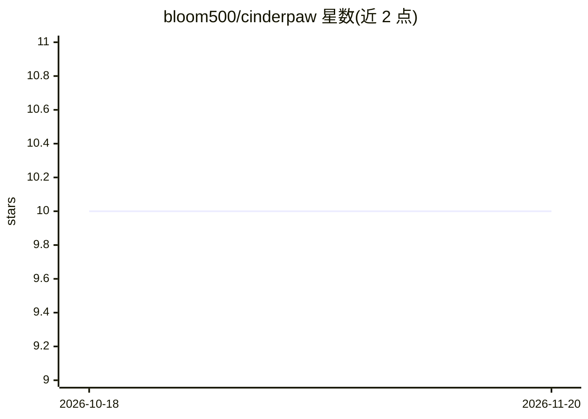

# bloom500/cinderpaw

⭐ 10 · TypeScript · Apache-2.0 · 推送 2026-11-17 · [GitHub](https://github.com/bloom500/cinderpaw) · [官网](https://cinderpaw.dev) · 组织维护

**桌面 AI 助手：替你操作文件、应用与浏览器，本地或云端模型**

以 Tauri 构建的桌面 AI agent，可读写本地文件、在可见浏览器中访问网页、回复 Telegram/Discord/Slack/WhatsApp 消息，并生成文档、PDF、表格或小应用后发送；支持语音输入操控，带可逐条删除的记忆列表与'注意力'机制（Dreams）供其复盘过往工作，该机制默认关闭、可设置花费上限。桌面版内置 llama.cpp 引擎可运行本地 GGUF 模型；npm/浏览器版为云端 CLI，不含本地推理引擎，需 BYOK 指向云服务商。

## 筛选速览

| 维度 | 判定 | 备注 |
|---|---|---|
| AI 角色 | `ai-native` | 本体是模型或模型工具 |
| 许可风险 | `permissive` | Apache-2.0 |
| 部署形态 | `desktop` | 安装包/桌面程序 |
| 模型依赖 | local-ok | 支持本地模型 |
| 硬件要求 | — | 无带数字的原话,不猜 |
| 安装摩擦 | `medium` | 含编译或系统依赖之一 |
| 成熟度 | `idea` | |

## 能力要点

- 本地 GGUF 模型与云 API（BYOK）双路径接入
- Dreams 机制复盘过往任务并保留有效做法，默认关闭
- 记忆以明文句子列出，每条带 Forget 按钮
- 内置 llama.cpp 推理引擎，CPU 可推理，支持 Vulkan GPU

## 适用场景

- 让 agent 帮我整理文件、生成文档或表格并发送
- 在本地机器上离线跑一个大模型当私人助手
- 通过 Telegram/Discord 等消息渠道与助手交互
- 用语音口述让电脑执行复制粘贴、截图等操作

## 场景标签

`AI 助手` `浏览器自动化` · 领域:效率与自动化

## 证据(README 行号)

> L25: Cinderpaw is a helper that lives on your computer, does real work with your
> L64: with OpenRouter in one click, or bring a key from OpenAI, Anthropic, Google or
> L168: > For **local GGUF models on your own machine, install the desktop app**

## 星数曲线

2026-10-18 10 → 2026-11-20 10（+0）

---
*卡片 v1 · prompt 1.4 · 生成 2026-11-19 · 置信度 high · 依据 README sha `6f26c2fee025` · [字段定义](../../DATASET.md)*
