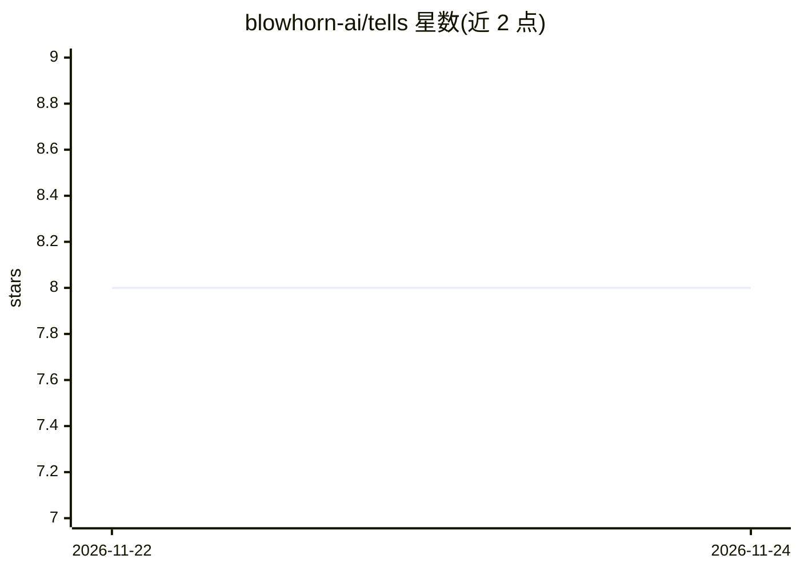

# blowhorn-ai/tells

⭐ 8 · JavaScript · Apache-2.0 · 推送 2026-11-21 · [GitHub](https://github.com/blowhorn-ai/tells) · 组织维护

**免费的浏览器机器人检测与指纹检查工具**

部署为 Cloudflare Worker 的在线检查服务（tells.blowhorn.ai），读取网站可见的机器人检测与指纹信号：服务器端请求头与数据中心 ASN 启发式、浏览器 canvas/WebGL/音频/字体指纹、跨上下文一致性比对、行为打分与可选交互测试，输出 0-100 分与 likely_human/suspicious/likely_bot 判定。提供 HTTP API（JSON schema 固定版本）、报告对比页与 CLI；CLI 默认经 Playwright 打开 headless Chromium 读取页面报告，--server-only 模式仅做服务器端检查。隐私部分明确声明评分在服务器进行并向 ipapi.is 发送 IP。

## 筛选速览

| 维度 | 判定 | 备注 |
|---|---|---|
| AI 角色 | `ai-native` | 本体是模型或模型工具 |
| 许可风险 | `permissive` | Apache-2.0 |
| 部署形态 | `library` | 以包/库形式分发 |
| 模型依赖 | — | README 未给出锁定关系 |
| 硬件要求 | — | 无带数字的原话,不猜 |
| 安装摩擦 | `low` | 无编译、无系统依赖或容器化 |
| 成熟度 | — | 结构信号不足 |

## 能力要点

- 服务器端 + 浏览器端 + 跨上下文一致性三层检测信号
- 指纹保护分类：stable/randomized/blocked/context-inconsistent
- JSON API 带 schema_version 与公开 check catalog（1.0.2）
- CLI 支持 npm/brew/npx 安装，退出码区分 human/suspicious/bot

## 适用场景

- 测试我的 Playwright/Puppeteer/Selenium 自动化脚本会被如何识别
- 检查我自己的浏览器向网站暴露了哪些指纹信号
- 对比修改指纹前后的两份报告差异

## 场景标签

`网络安全` `浏览器自动化` · 领域:效率与自动化

## 证据(README 行号)

> L3: **Am I a Bot?** A free check of what websites can see about your browser: the bot-detection and fingerprinting signa
> L5: It runs at tells.blowhorn.ai as one Cloudflare Worker with static assets. Use it to test your own browser, or point 
> L23: ## API for scripts

## 星数曲线

2026-11-22 8 → 2026-11-24 8（+0）

---
*卡片 v1 · prompt 1.4 · 生成 2026-11-22 · 置信度 high · 依据 README sha `75ed86e49f55` · [字段定义](../../DATASET.md)*
