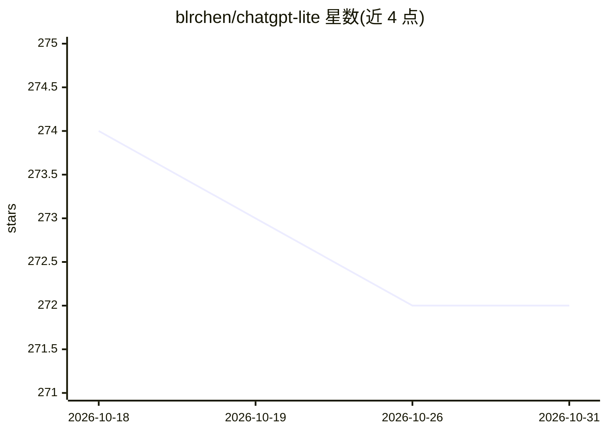

# blrchen/chatgpt-lite

⭐ 272 · TypeScript · MIT · 推送 2026-04-19 · [GitHub](https://github.com/blrchen/chatgpt-lite) · [官网](https://gptlite.vercel.app) · 个人维护 · 中文 README

**可私有部署的 ChatGPT 网页应用（Next.js）**

基于 Next.js 的自托管 ChatGPT 聊天界面：提供 SSE 流式输出、Markdown 渲染、人格系统、多会话管理、文件上传、语音输入与联网搜索。支持 OpenAI、Azure OpenAI 及 OpenAI 兼容接口，通过环境变量配置 API Key。可一键部署到 Vercel 或用 Docker 运行，本地开发需 Node.js 22+ 与 npm。聊天记录保存在本地，无需服务端数据库。项目在 ChatGPT Minimal 基础上扩展，另有轻量版本可选。

## 筛选速览

| 维度 | 判定 | 备注 |
|---|---|---|
| AI 角色 | `ai-native` | 本体是模型或模型工具 |
| 许可风险 | `permissive` | MIT |
| 部署形态 | `self-host` | docker 或自建部署 |
| 模型依赖 | locked-api |  |
| 硬件要求 | — | 无带数字的原话,不猜 |
| 安装摩擦 | `low` | 无编译、无系统依赖或容器化 |
| 成熟度 | — | 结构信号不足 |

## 能力要点

- SSE 实时流式输出与 Markdown 语法高亮渲染
- 支持 OpenAI、Azure OpenAI 与 OpenAI 兼容接口
- 人格系统、多会话管理、文件上传与语音输入
- 提供 Docker 与 Vercel 部署方式，聊天记录本地保存

## 适用场景

- 想私有化部署一个聊天界面连接自己的 OpenAI/Azure 账号
- 在桌面和移动端统一使用带多会话管理的 AI 聊天应用
- 通过自定义人格切换不同系统提示词的对话风格

## 场景标签

`聊天机器人` · 领域:对话与助手

## 证据(README 行号)

> L5: ChatGPT Lite is a feature-rich, self-hostable ChatGPT app. Built with Next.js. Ready to deploy and use.
> L27: - **Supports OpenAI, Azure OpenAI, and OpenAI-compatible providers**

## 星数曲线

2026-10-18 274 → 2026-10-31 272（-2）

---
*卡片 v1 · prompt 1.4 · 生成 2026-10-22 · 置信度 high · 依据 README sha `65926b06d875` · [字段定义](../../DATASET.md)*
