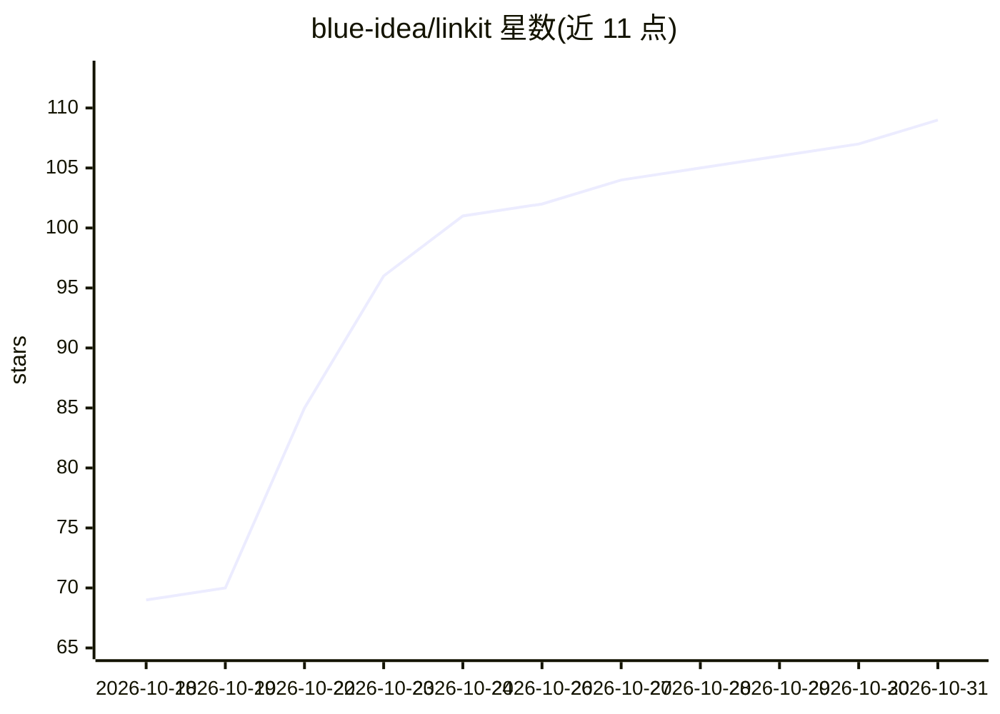

# blue-idea/linkit

⭐ 109 · JavaScript · MIT · 推送 2026-10-29 · [GitHub](https://github.com/blue-idea/linkit) · [官网](https://github.com/blue-idea/linkit/releases) · 个人维护 · 中文 README

**带 AI 摘要与语义搜索的书签/知识管理桌面应用**

面向知识工作者的桌面书签管理器，基于 Wails (Go) + React 构建，提供本地 SQLite 优先存储与基于 Supabase RLS 的免费云同步双轨模式。功能包括 AI 摘要与自动标签、语义搜索、AI 策展集合、知识图谱可视化、重复与死链检测、浏览器书签一键导入（Chrome/Firefox/Edge/Safari）。AI 能力需用户自行配置 OpenAI/DeepSeek 兼容 API 或本地模型（Ollama/vLLM 等），不内置 LLM 服务；去掉 AI 后书签管理功能仍可用。提供 macOS/Windows/Linux 安装包。

## 筛选速览

| 维度 | 判定 | 备注 |
|---|---|---|
| AI 角色 | `ai-enhanced` | 去掉 AI 部分产品仍成立 |
| 许可风险 | `none` | MIT |
| 部署形态 | `desktop` | 安装包/桌面程序 |
| 模型依赖 | local-ok | 支持本地模型 |
| 硬件要求 | — | 无带数字的原话,不猜 |
| 安装摩擦 | `low` | 无编译、无系统依赖或容器化 |
| 成熟度 | — | 结构信号不足 |

## 能力要点

- AI 摘要、智能标签与全库语义搜索（需自配 OpenAI/DeepSeek 兼容 API 或本地 LLM）
- 本地 SQLite 优先存储 + Supabase RLS 免费云同步双轨模式
- AI 策展集合、知识图谱可视化与重复/死链检测
- 一键导入 Chrome/Firefox/Edge/Safari 等浏览器书签

## 适用场景

- 整理多年积压的书签并找回想读的链接
- 通过语义搜索和 AI 摘要快速定位已收藏的内容
- 多设备间免费同步书签库
- 用自然语言让 AI 自动归类整理书签集合

## 场景标签

`知识库管理` `语义搜索` · 领域:知识与检索

## 证据(README 行号)

> L17: **Linkit** is a desktop bookmark manager built for knowledge workers. AI summaries, semantic search, and a knowledg
> L99: > **Note**: Linkit does not provide built-in LLM services or API keys by default; users need to configure their own
> L191: - **Desktop Framework**: Wails (Go)

## 星数曲线

2026-10-18 69 → 2026-10-31 109（+40）

---
*卡片 v1 · prompt 1.4 · 生成 2026-10-23 · 置信度 high · 依据 README sha `c1b51c211a6d` · [字段定义](../../DATASET.md)*
