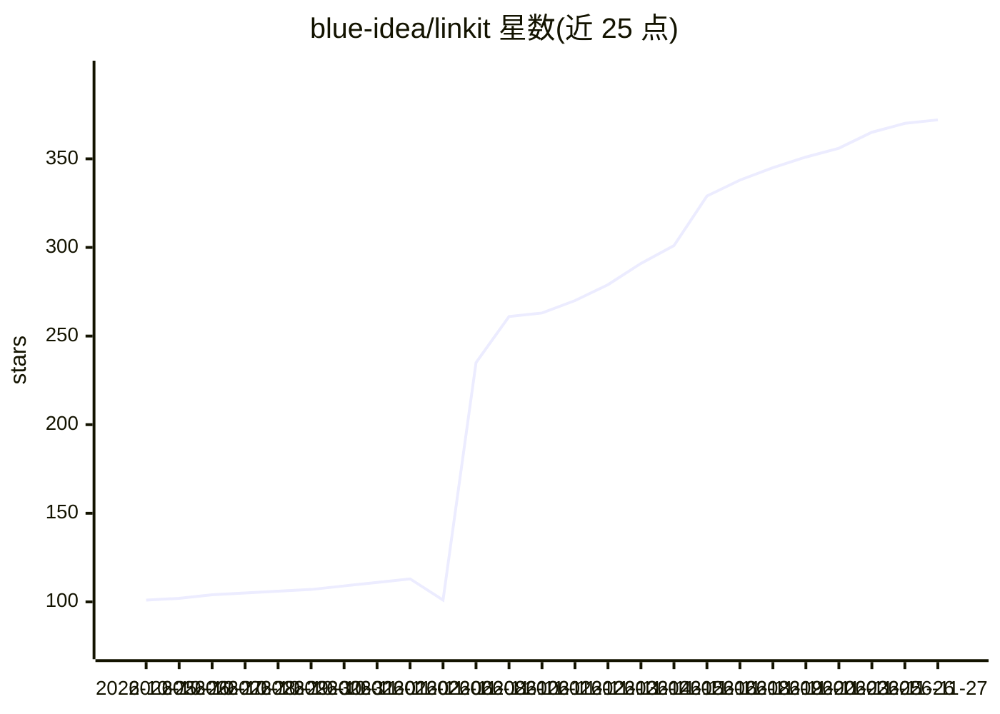

# blue-idea/linkit

⭐ 372 · JavaScript · MIT · 推送 2026-11-20 · [GitHub](https://github.com/blue-idea/linkit) · [官网](https://github.com/blue-idea/linkit/releases) · 个人维护 · 中文 README

**本地优先桌面书签管理器：AI 摘要、语义搜索与知识图谱**

面向知识工作者的桌面书签与个人知识管理工具，基于 Go + Wails + React 构建，覆盖 macOS/Windows/Linux。数据默认存于本地 SQLite，可选 Supabase 自托管云同步。AI 功能包括页面摘要、标签推荐、语义搜索、AI 策展合集与重复检测；默认不提供内置 LLM 服务，用户需自配 OpenAI/DeepSeek 兼容 API 或本地模型。提供浏览器书签一键导入、链接健康检查、批量操作与 12 套主题。注意：仓库仅分发预编译二进制，应用源码未发布。

## 筛选速览

| 维度 | 判定 | 备注 |
|---|---|---|
| AI 角色 | `ai-enhanced` | 去掉 AI 部分产品仍成立 |
| 许可风险 | `permissive` | MIT |
| 部署形态 | `desktop` | 安装包/桌面程序 |
| 模型依赖 | local-ok | 支持本地模型 |
| 硬件要求 | — | 无带数字的原话,不猜 |
| 安装摩擦 | `low` | 无编译、无系统依赖或容器化 |
| 成熟度 | — | 结构信号不足 |

## 能力要点

- 本地 SQLite 存储，无需账号、无遥测，离线可用
- 支持接入 OpenAI/DeepSeek 兼容 API 或 Ollama 等本地模型
- 语义搜索、知识图谱与 AI 策展合集
- 支持 Chrome/Firefox/Safari/Edge 书签一键导入与自托管云同步

## 适用场景

- 把散落在多个浏览器的书签迁移到本地统一管理
- 用 AI 摘要和语义搜索盘点半读的收藏内容
- 多设备间免费同步书签库

## 场景标签

`知识库管理` `知识图谱` `语义搜索` · 领域:知识与检索

## 证据(README 行号)

> L17: **Linkit** is a desktop bookmark manager built for knowledge workers. AI summaries, semantic search, and a knowledg
> L30: |**AI**|Summarization, semantic search, knowledge graph — bring your own OpenAI-compatible API or local model (Olla
> L119: > **Note**: Linkit does not provide built-in LLM services or API keys by default; users need to configure their ow

## 星数曲线

2026-10-25 101 → 2026-11-27 372（+271）

---
*卡片 v1 · prompt 1.4 · 生成 2026-11-25 · 置信度 high · 依据 README sha `ae3cfe2d442c` · [字段定义](../../DATASET.md)*
