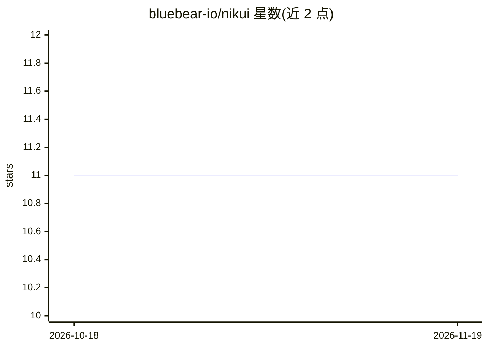

# bluebear-io/nikui

⭐ 11 · Python · Apache-2.0 · 推送 2026-03-09 · [GitHub](https://github.com/bluebear-io/nikui) · 个人维护

**LLM+静态分析+Git churn 定位代码坏味道热点**

面向维护者的代码坏味道与技术债分析器：组合 LLM 语义分析（SOLID 违例、静默失败、god object 等）、Semgrep 安全扫描、Simhash 候选经 LLM 验证的结构性重复检测与 Flake8 客观指标，并以 Stench × Churn 热点矩阵把发现按 Git 修改频率排序，输出可排序的 HTML 报告。支持 --diff 差量扫描与 GitHub Action CI 模式，缓存 Simhash 指纹避免全量重建。LLM 为可选阶段，无后端时跳过语义与重复验证环节。

## 筛选速览

| 维度 | 判定 | 备注 |
|---|---|---|
| AI 角色 | `ai-native` | 本体是模型或模型工具 |
| 许可风险 | `permissive` | Apache-2.0 |
| 部署形态 | `library` | 以包/库形式分发 |
| 模型依赖 | local-ok | 支持本地模型 |
| 硬件要求 | — | 无带数字的原话,不猜 |
| 安装摩擦 | `low` | 无编译、无系统依赖或容器化 |
| 成熟度 | — | 结构信号不足 |

## 能力要点

- LLM 语义分析配合 Semgrep/Flake8/Simhash 多源检测
- Stench × Churn 热点矩阵区分 Toxic/Frozen/Quick Win/Healthy 象限
- --diff 差量模式与 Simhash 缓存面向 CI 场景
- LLM 可选：无后端时跳过语义分析阶段

## 适用场景

- PR 前定位最近改动中技术债集中的文件
- 为遗留代码库生成坏味道优先级报告
- 在 CI 中对新改动做差量质量门禁

## 场景标签

`代码审查` · 领域:编码与开发

## 证据(README 行号)

> L10: **Stop guessing where your technical debt is.** Nikui combines LLM semantic reasoning with Git churn to prioritize 
> L23: - **LLM Semantic Analysis:** Detects SOLID violations, silent failures, god objects, and other deep structural issu
> L100: > **LLM is optional.** If no backend is running, the semantic analysis and duplication verification stages are ski

## 星数曲线

2026-10-18 11 → 2026-11-19 11（+0）

---
*卡片 v1 · prompt 1.4 · 生成 2026-11-18 · 置信度 mid · 依据 README sha `243459cf2042` · [字段定义](../../DATASET.md)*
