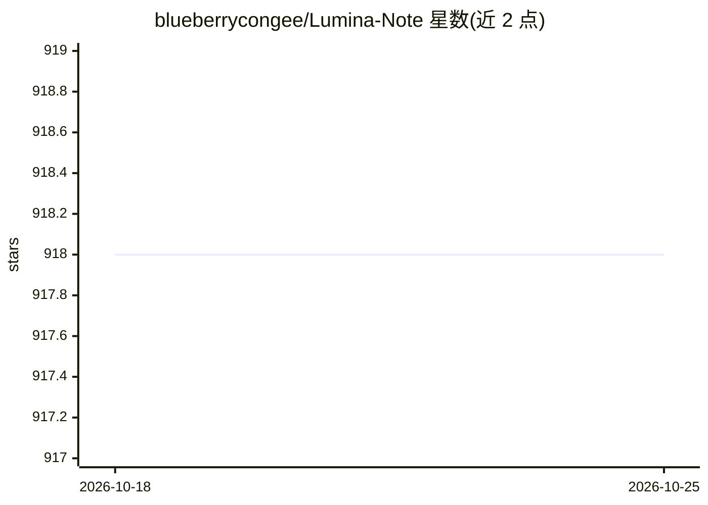

# blueberrycongee/Lumina-Note

⭐ 918 · TypeScript · Apache-2.0 · 推送 2026-08-13 · [GitHub](https://github.com/blueberrycongee/Lumina-Note) · 个人维护 · 中文 README

**带 AI agent 的本地优先 Markdown 笔记应用**

基于 Electron 41 的桌面端 Markdown 笔记应用（React 18/TypeScript 渲染层、CodeMirror 编辑器）：本地磁盘上的纯 Markdown vault，支持实时预览、WikiLinks、双向链接、知识图谱、PDF/图片/闪卡；内嵌基于 opencode SDK 的 agent，可读写、重组、总结、关联笔记。模型路由可选自有 API key、Ollama、OpenAI 兼容端点或 Lumina Cloud 许可。提供 Windows/macOS/Linux 安装包，Node.js 22+ 从源码构建，附 iOS/Android 伴侣应用。

## 筛选速览

| 维度 | 判定 | 备注 |
|---|---|---|
| AI 角色 | `ai-enhanced` | 去掉 AI 部分产品仍成立 |
| 许可风险 | `permissive` | Apache-2.0 |
| 部署形态 | `desktop` | 安装包/桌面程序 |
| 模型依赖 | local-ok | 支持本地模型 |
| 硬件要求 | — | 无带数字的原话,不猜 |
| 安装摩擦 | `low` | 无编译、无系统依赖或容器化 |
| 成熟度 | `idea` | |

## 能力要点

- 本地磁盘纯 Markdown vault，不依赖应用本身即可读写备份
- opencode SDK 驱动的 agent 可跨 vault 读写/重组/总结/生成闪卡
- 多模型路由：OpenAI/Anthropic/Gemini/DeepSeek/Ollama/OpenRouter 等
- WikiLinks、backlinks、图谱视图与开发者预览插件系统

## 适用场景

- 用带双向链接和图谱的本地 Markdown 笔记管理知识
- 让内嵌 agent 整理文件夹、总结 PDF、生成闪卡
- 自带 API key 或本地 Ollama 模型控制 AI 路由

## 场景标签

`知识库管理` `文档问答` · 领域:知识与检索

## 证据(README 行号)

> L7: Lumina Note starts as a fast, local Markdown workspace that stays comfortable for people to read and edit directly. 
> L25: - **Agent-native assistance**: Lumina embeds an opencode-powered agent that can read, write, reorganize, summarize,
> L41: - Keep control of model routing with OpenAI, Anthropic Claude, Google Gemini, DeepSeek, Moonshot Kimi, Zhipu GLM, M

## 星数曲线

2026-10-18 918 → 2026-10-25 918（+0）

---
*卡片 v1 · prompt 1.4 · 生成 2026-10-21 · 置信度 high · 依据 README sha `db62615a4480` · [字段定义](../../DATASET.md)*
