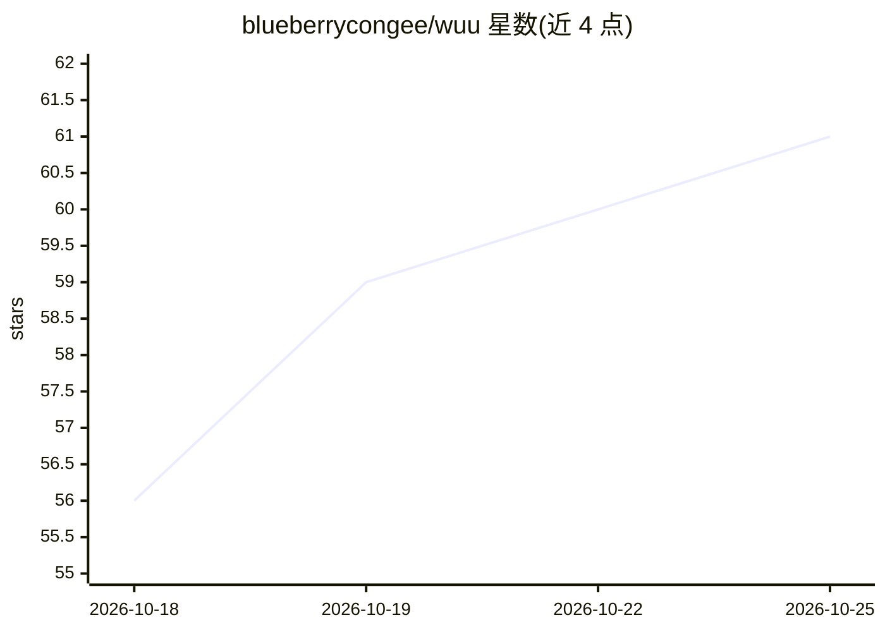

# blueberrycongee/wuu

⭐ 61 · Go · MIT · 推送 2026-10-24 · [GitHub](https://github.com/blueberrycongee/wuu) · 组织维护 · 中文 README

**BYOK AI 编码 agent：桌面应用+可脚本化 CLI，Agent 直接读写本地项目代码**

开源桌面应用（Go + Electron，MIT 协议）：指向项目文件夹、描述任务后由 agent 读代码、运行命令并编辑文件；对话旁的 Review 面板展示磁盘上的实际 Git diff。支持接入 OpenAI/Anthropic/DeepSeek/xAI/Kimi/Z.AI/MiniMax/阿里云等 API key，也可经 OpenRouter、SiliconFlow、LM Studio 或自定义兼容端点，还能复用 Codex 登录或 xAI 订阅，并可作为引擎驱动 Claude Code、Cursor、Devin 等其他 agent。提供权限模式、macOS Seatbelt 沙箱、Computer Use、插件与 CLI。桌面预览仅限 Apple silicon Mac；CLI 需 Go 从源码构建。

## 筛选速览

| 维度 | 判定 | 备注 |
|---|---|---|
| AI 角色 | `ai-native` | 本体是模型或模型工具 |
| 许可风险 | `permissive` | MIT |
| 部署形态 | `None` |  |
| 模型依赖 | locked-api |  |
| 硬件要求 | — | 无带数字的原话,不猜 |
| 安装摩擦 | `medium` | 含编译或系统依赖之一 |
| 成熟度 | `idea` | |

## 能力要点

- BYOK 接入多家模型服务商与网关、本地服务器及自定义端点
- 可复用 Codex/xAI 订阅，或以 Claude Code/Cursor/Devin 等作为会话引擎
- Review 面板按文件展示 Git diff，替代仅信任总结
- 权限模式（Read-only/Standard/Unconfined）与 macOS Seatbelt 沙箱；工具可运行于 Docker/SSH/沙箱

## 适用场景

- 让 AI agent 在本地项目里读代码、跑命令并改文件，同时逐文件核对 diff
- 带自己的 API key 或现有订阅使用编码 agent
- 在终端/脚本中用 CLI 与 JSONL 输出跑自动化任务

## 场景标签

`编码 Agent` · 领域:编码与开发

## 证据(README 行号)

> L14: Point wuu at a folder, describe the task, and let an agent read the code, run commands and edit files. The conversa
> L36: Connect OpenAI, Anthropic, DeepSeek, xAI, Kimi, Z.AI, MiniMax or Alibaba Cloud Model Studio with an API key. Gatewa

## 星数曲线

2026-10-18 56 → 2026-10-25 61（+5）

---
*卡片 v1 · prompt 1.4 · 生成 2026-10-24 · 置信度 high · 依据 README sha `0e239b2cb97e` · [字段定义](../../DATASET.md)*
