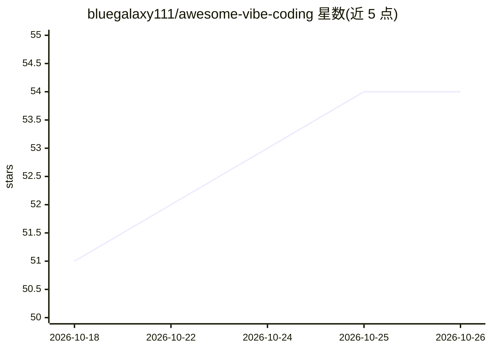

# bluegalaxy111/awesome-vibe-coding

⭐ 54 · Python · CC0-1.0 · 推送 2026-04-19 · [GitHub](https://github.com/bluegalaxy111/awesome-vibe-coding) · 个人维护

**AI 编程工具精选清单：300+ 工具平台与选型指南**

由个人维护的 vibe coding（对话式 AI 编程）主题 awesome 清单：按四级使用者路径（零经验、AI IDE、终端 agent、自主 SWE）组织选型决策指南，收录 Cursor、Claude Code、Aider、OpenHands、Devin 等 AI 编程工具与平台，按 IDE 类、终端 CLI 类等分类，标注定价与开源属性。另提供 .cursorrules/CLAUDE.md 模板、提示词配方与起步环境配置指南。维护者称会在收录前亲自测试工具。

## 筛选速览

| 维度 | 判定 | 备注 |
|---|---|---|
| AI 角色 | `ai-knowledge` | 知识聚合/清单类 |
| 许可风险 | `viral` | CC0-1.0 |
| 部署形态 | `self-host` | docker 或自建部署 |
| 模型依赖 | — | README 未给出锁定关系 |
| 硬件要求 | — | 无带数字的原话,不猜 |
| 安装摩擦 | `low` | 无编译、无系统依赖或容器化 |
| 成熟度 | — | 结构信号不足 |

## 能力要点

- 按四级经验路径组织的选型决策指南
- 收录 Cursor/Claude Code/Aider/OpenHands 等工具并标注定价与开源属性
- 提供 .cursorrules、CLAUDE.md 模板与提示词配方

## 适用场景

- 挑选适合自己经验水平的 AI 编程工具
- 比较 Cursor 与 Windsurf 等 IDE 或终端 agent
- 获取 .cursorrules 与提示词模板提升 AI 工具效果

## 场景标签

`精选清单` · 领域:学习与行业

## 证据(README 行号)

> L7: The definitive handbook for the next era of software development. Vibe coding simplifies development through AI agen
> L15: > **Note from the maintainer:** I built this handbook because I was drowning in AI coding tool launches and couldn'
> L118: ## Contents

## 星数曲线

2026-10-18 51 → 2026-10-26 54（+3）

---
*卡片 v1 · prompt 1.4 · 生成 2026-10-24 · 置信度 mid · 依据 README sha `c62c7b68fadf` · [字段定义](../../DATASET.md)*
