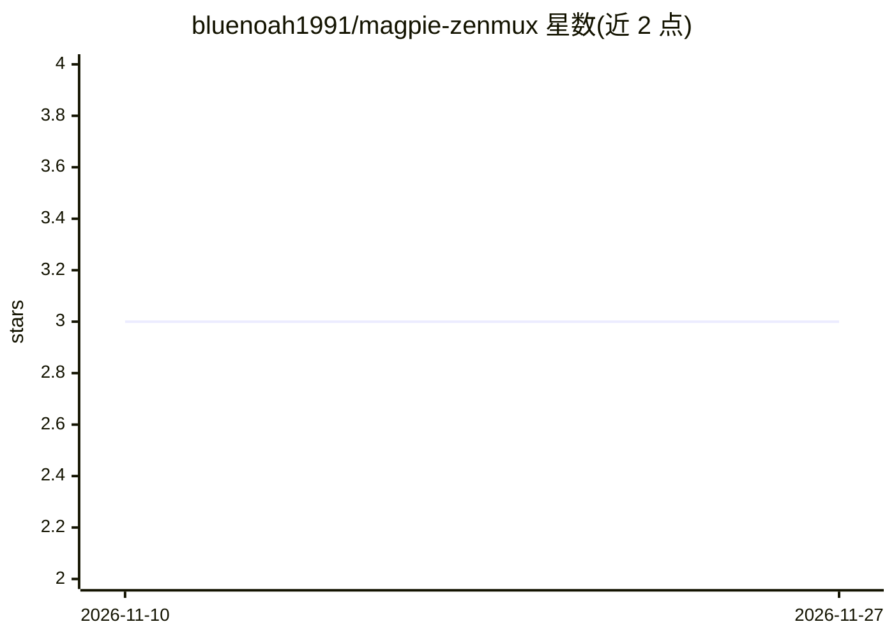

# bluenoah1991/magpie-zenmux

⭐ 3 · JavaScript · MIT · 推送 2026-11-10 · [GitHub](https://github.com/bluenoah1991/magpie-zenmux) · 个人维护

**在 Magpie 中接入 ZenMux 模型的 provider 插件**

Magpie 的 provider 插件，让用户在 Magpie 中使用 ZenMux Builder Plan 或 Pay As You Go 账户。提供模型发现（启用订阅账户发现后供 agent 调用插件内模型）、原生协议路由、流式输出与 tool calling，对支持的模型提供 reasoning levels。通过 Magpie 插件页面以对应计划的 API key 登录启用；可另配 management API key 查看订阅配额或 PAYG 余额。限制：模型访问取决于所选计划，插件不会自动切换计费计划；图像生成需兼容的 Gemini 客户端。

## 筛选速览

| 维度 | 判定 | 备注 |
|---|---|---|
| AI 角色 | `ai-ecosystem` | LLM/agent 周边工具 |
| 许可风险 | `permissive` | MIT |
| 部署形态 | `None` |  |
| 模型依赖 | — | README 未给出锁定关系 |
| 硬件要求 | — | 无带数字的原话,不猜 |
| 安装摩擦 | `low` | 无编译、无系统依赖或容器化 |
| 成熟度 | — | 结构信号不足 |

## 能力要点

- 模型发现：启用订阅账户发现后 agent 可使用插件内模型
- 支持流式输出与 tool calling，部分模型提供 reasoning levels
- 可选 management API key 在 Magpie 内查看订阅配额或 PAYG 余额
- Builder Plan 与 PAYG 使用独立 key，不自动切换计费计划

## 适用场景

- 在 Magpie 的 agent 会话中调用 ZenMux 上的模型
- 统一查看 Builder Plan 订阅配额或 PAYG 余额
- 在 agent 工作流中使用带 tool calling 的模型

## 场景标签

`模型网关` · 领域:Agent 开发

## 证据(README 行号)

> L1: # ZenMux for Magpie
> L3: Use ZenMux Builder Plan or Pay As You Go in Magpie, with streaming, tool calling, and reasoning levels for supported

## 星数曲线

2026-11-10 3 → 2026-11-27 3（+0）

---
*卡片 v1 · prompt 1.4 · 生成 2026-11-22 · 置信度 high · 依据 README sha `11c894e5132f` · [字段定义](../../DATASET.md)*
