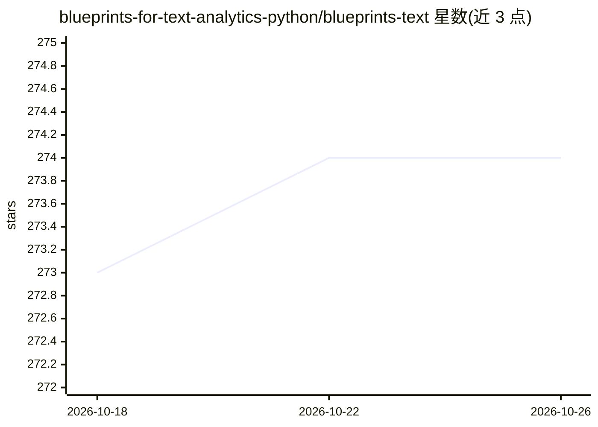

# blueprints-for-text-analytics-python/blueprints-text

⭐ 274 · Jupyter Notebook · Apache-2.0 · 推送 2026-05-28 · [GitHub](https://github.com/blueprints-for-text-analytics-python/blueprints-text) · 组织维护

**O'Reilly《Blueprints for Text Analytics Using Python》配套代码 notebook 集**

O'Reilly 2020 年出版的 Python 文本分析书籍的官方代码仓库：按 13 个章节组织 Jupyter notebook，覆盖数据抓取、特征工程、文本分类、主题建模、摘要、词嵌入、情感分析、知识图谱与生产化部署等。每章提供 GitHub 查看、nbviewer 与 Google Colab 直接运行三种入口；本地运行推荐 Miniconda 建环境并启用 Jupyter 扩展。限制：仓库自述处于准备阶段，代码基于 spaCy 2.3.2 与 gensim 3.8.3，spaCy 3.0 适配仍在更新中。

## 筛选速览

| 维度 | 判定 | 备注 |
|---|---|---|
| AI 角色 | `ai-knowledge` | 知识聚合/清单类 |
| 许可风险 | `permissive` | Apache-2.0 |
| 部署形态 | `None` |  |
| 模型依赖 | — | README 未给出锁定关系 |
| 硬件要求 | — | 无带数字的原话,不猜 |
| 安装摩擦 | `low` | 无编译、无系统依赖或容器化 |
| 成熟度 | `idea` | |

## 能力要点

- 13 章配套 Jupyter notebook，覆盖文本分类、主题建模、情感分析、知识图谱等
- 每章提供 nbviewer 查看与 Google Colab 在线运行入口
- 提供第 7 章《How to Explain a Classifier》免费下载
- 本地环境通过 conda 环境文件（blueprints.yml）一键创建

## 适用场景

- 跟着书学习 Python 文本分析与 NLP 工程实践
- 在 Colab 上直接运行书中代码示例
- 查阅文本分类、主题建模等常见 NLP 任务的参考实现

## 场景标签

`教程课程` · 领域:学习与行业

## 证据(README 行号)

> L29: This repository contains the code examples of our O'Reilly book. You will find a subdirectory for each chapter cont
> L31: Below you find the links to view the notebooks here on Github or execute them directly on Google Colab. In the sect

## 星数曲线

2026-10-18 273 → 2026-10-26 274（+1）

---
*卡片 v1 · prompt 1.4 · 生成 2026-10-22 · 置信度 high · 依据 README sha `58626e0ccb28` · [字段定义](../../DATASET.md)*
