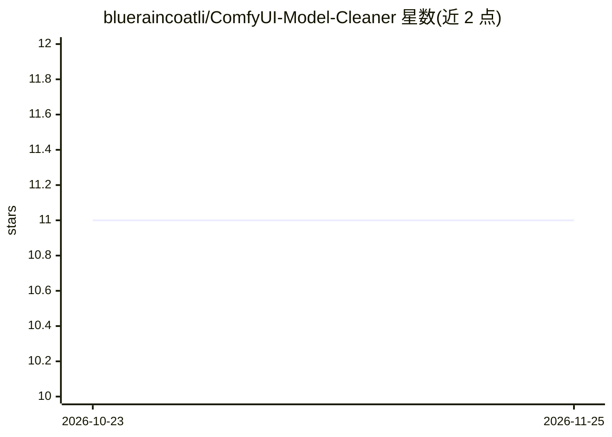

# blueraincoatli/ComfyUI-Model-Cleaner

⭐ 11 · Python · MIT · 推送 2025-12-18 · [GitHub](https://github.com/blueraincoatli/ComfyUI-Model-Cleaner) · 个人维护 · 中文 README

**为 ComfyUI 用户扫描清理不再使用的模型文件**

ComfyUI 自定义节点，用于定位并清理因节点卸载或项目结束而遗留的"孤儿模型"文件。通过分析工作流、自定义节点代码及（可选的）GitHub 仓库文档，提取模型引用，对每个模型给出 0-100 的未使用置信度评分；提供预览、备份、回收站三种安全清理模式与节点内交互式选择界面。README 明确说明扫描基于多因素综合判断，准确性无法保证，需人工核验。支持中英文界面自动切换，通过 git clone 手动安装到 custom_nodes 目录。

## 筛选速览

| 维度 | 判定 | 备注 |
|---|---|---|
| AI 角色 | `ai-enhanced` | 去掉 AI 部分产品仍成立 |
| 许可风险 | `permissive` | MIT |
| 部署形态 | `library` | 以包/库形式分发 |
| 模型依赖 | — | README 未给出锁定关系 |
| 硬件要求 | — | 无带数字的原话,不猜 |
| 安装摩擦 | `low` | 无编译、无系统依赖或容器化 |
| 成熟度 | — | 结构信号不足 |

## 能力要点

- 多源引用检测：从代码、配置与文档提取模型引用，多级匹配算法
- 0-100 未使用置信度评分与 Exact/Partial/Fuzzy/Path 匹配类型
- 预览/备份/回收站三种安全清理模式，支持自动备份与路径记录恢复
- 可选 GitHub 增强模式，从仓库 README 等文档提取引用

## 适用场景

- 卸载多个 ComfyUI 自定义节点后清理遗留的模型文件释放磁盘空间
- 长期使用 ComfyUI 后整理混乱的 models 目录
- 用预览与备份模式安全地批量清理不再使用的 checkpoints、LoRAs 等模型

## 场景标签

 · 领域:AI 工作流/模型管理工具

## 证据(README 行号)

> L7: **ComfyUI Model Cleaner** aims to solve this problem. It is a utility tool designed for ComfyUI that helps you ident
> L21: - 🔗 **Multi-source Reference Detection**: Extracts references from code, configurations, and documents.
> L22: - 🎯 **Intelligent Matching Algorithm**: Multi-level matching strategy to improve accuracy.

## 星数曲线

2026-10-23 11 → 2026-11-25 11（+0）

---
*卡片 v1 · prompt 1.4 · 生成 2026-11-18 · 置信度 mid · 依据 README sha `567a91f47426` · [字段定义](../../DATASET.md)*
