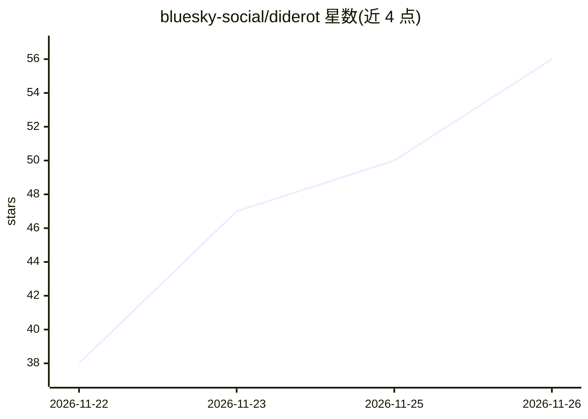

# bluesky-social/diderot

⭐ 56 · Go · Apache-2.0 · 推送 2026-11-25 · [GitHub](https://github.com/bluesky-social/diderot) · [官网](https://diderot.dev) · 组织维护

**自托管企业知识问答：跨 Slack、编码会话、文档检索并带引用作答**

单服务器形式部署的组织知识搜索与问答系统：将 Slack、Discord、编码-agent 会话、Notion、Linear、Zendesk 与 Markdown 文件摄入 Postgres 事件日志，向量嵌入到 Qdrant，检索仅用向量近邻（无重排序与关键词索引），agent 调用 retrieve/list/expand 工具并生成带内联引用的回答。回答通过 Slack @提及、DM、HTTP API 或内置 MCP 服务器交付；每个事件携带权限 scope，搜索按调用者权限过滤。管理通过浏览器 /admin 完成。

## 筛选速览

| 维度 | 判定 | 备注 |
|---|---|---|
| AI 角色 | `ai-native` | 本体是模型或模型工具 |
| 许可风险 | `permissive` | Apache-2.0 |
| 部署形态 | `self-host` | docker 或自建部署 |
| 模型依赖 | local-ok | 支持本地模型 |
| 硬件要求 | — | 无带数字的原话,不猜 |
| 安装摩擦 | `low` | 无编译、无系统依赖或容器化 |
| 成熟度 | `idea` | |

## 能力要点

- 摄入 Slack/Discord/编码会话/Notion/Linear/Zendesk/Markdown 多类来源，向量检索并附引用作答
- 内置 MCP 服务器（retrieve/list/expand/attachment/ask），供自有 agent 调用
- 基于 scope 的权限模型：私有频道仅成员可见，每次搜索按调用者 scope 过滤
- 管理 UI 配置任意模型提供方（OpenAI/Anthropic/OpenAI 兼容端点）并按任务分派模型

## 适用场景

- 在 Slack 中 @提及即可询问团队决定、历史讨论与文档内容
- 让自己的编码 agent 通过 MCP 检索组织知识
- 将 PagerDuty 告警与部署历史等接入调查流程

## 场景标签

`RAG` `文档问答` · 领域:知识与检索

## 证据(README 行号)

> L3: Diderot answers questions about what your organization has written down. It
> L6: searches that corpus and answers with citations: in Slack, and as an MCP
> L31: - **Ask.** An agent that calls `retrieve`, `list`, and `expand` over the

## 星数曲线

2026-11-22 38 → 2026-11-26 56（+18）

---
*卡片 v1 · prompt 1.4 · 生成 2026-11-22 · 置信度 high · 依据 README sha `58d654bed7d5` · [字段定义](../../DATASET.md)*
