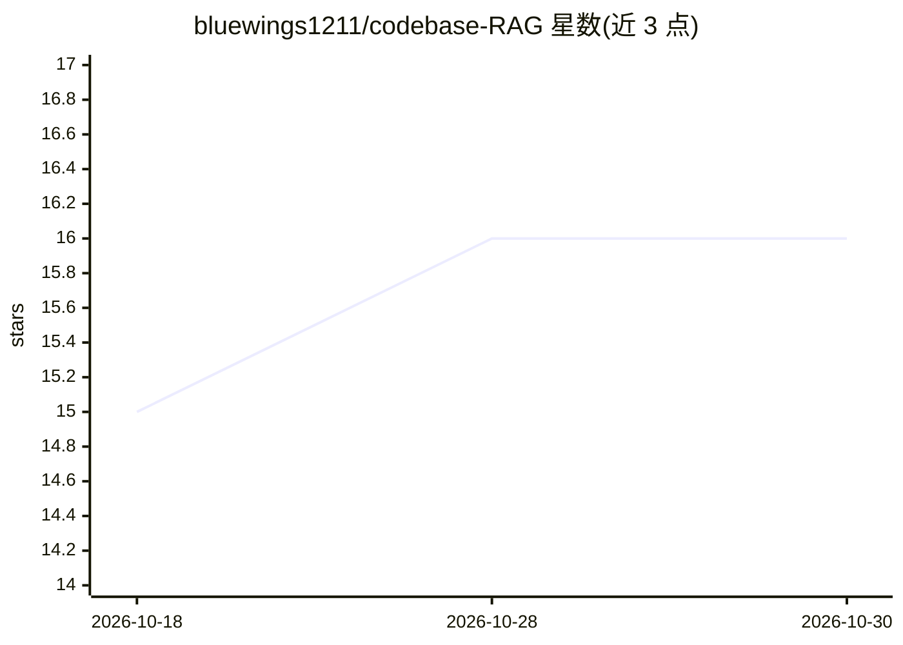

# bluewings1211/codebase-RAG

⭐ 16 · Python · MIT · 推送 2025-12-11 · [GitHub](https://github.com/bluewings1211/codebase-RAG) · 个人维护

**帮助 AI agent 与开发者理解和检索代码库的 RAG MCP 服务器**

面向 AI agent 和开发者的 MCP 服务器：将本地目录或 GitHub 仓库索引进 Qdrant 向量数据库，使 LLM 可对代码进行语义搜索并获取代码片段。机制上用 Tree-sitter 将代码解析为函数/类做智能分块，采用两阶段 RAG（Qwen3-Reranker 交叉编码器重排，README 称 22-31% 准确率提升），支持增量索引、多语言解析（Python/JS/TS/Go/Rust/Java/C++ 等）与 macOS MPS 加速。通过 setup.sh 安装，接入 Claude Desktop 等 MCP 客户端使用。MIT 许可。

## 筛选速览

| 维度 | 判定 | 备注 |
|---|---|---|
| AI 角色 | `ai-ecosystem` | LLM/agent 周边工具 |
| 许可风险 | `permissive` | MIT |
| 部署形态 | `None` |  |
| 模型依赖 | — | README 未给出锁定关系 |
| 硬件要求 | — | 无带数字的原话,不猜 |
| 安装摩擦 | `low` | 无编译、无系统依赖或容器化 |
| 成熟度 | — | 结构信号不足 |

## 能力要点

- 索引进 Qdrant 向量数据库，支持语义搜索代码
- Tree-sitter 智能分块（函数/类级）与 Qwen3-Reranker 两阶段重排
- 增量索引与 macOS MPS 加速
- 支持 Python、JavaScript、TypeScript、Go、Rust、Java、C++ 等多语言

## 适用场景

- 让 Claude Desktop 等 MCP 客户端直接检索问答我的代码库
- 为 AI agent 提供代码库语义检索工具
- 索引 GitHub 仓库后按语义定位代码片段

## 场景标签

`RAG` · 领域:知识与检索

## 证据(README 行号)

> L3: A Retrieval-Augmented Generation (RAG) Model-Controller-Provider (MCP) server designed to assist AI agents and devel
> L15: This tool allows you to "chat" with your code. It indexes your local directories or GitHub repositories into a vect

## 星数曲线

2026-10-18 15 → 2026-10-30 16（+1）

---
*卡片 v1 · prompt 1.4 · 生成 2026-10-30 · 置信度 high · 依据 README sha `092b24e6e02d` · [字段定义](../../DATASET.md)*
