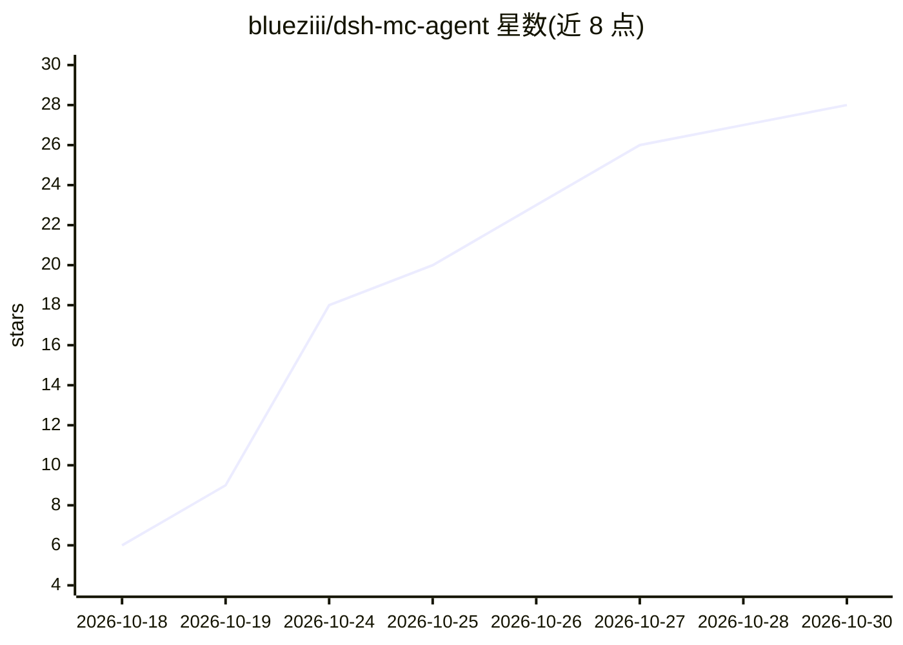

# blueziii/dsh-mc-agent

⭐ 28 · JavaScript · MIT · 推送 2026-10-29 · [GitHub](https://github.com/blueziii/dsh-mc-agent) · 个人维护 · 中文 README

**DSH 的 Minecraft 插件：给 AI 40 个工具实际进服玩游戏**

DeepSeek Harness（DSH）的插件包，基于 yzi1b/whale-craft 魔改独立维护。通过 40 个 mc_* 工具让 AI 以 mineflayer 机器人身份进入 Minecraft 服务器，实现寻路、挖矿、合成、熔炼、村民交易、按图盖房、第一人称观察与战斗（威胁评估、放风筝、换武器）等行为。自主层默认 ai-led 模式只监测与叫醒不代操作；单次调用 ≤11 秒分片返回；操作结果需回读证据。安装需 Node.js >= 22、DSH 与可用的 MC 服务器，通过 pnpm 安装并加装多个 mineflayer 系列依赖。

## 筛选速览

| 维度 | 判定 | 备注 |
|---|---|---|
| AI 角色 | `ai-ecosystem` | LLM/agent 周边工具 |
| 许可风险 | `permissive` | MIT |
| 部署形态 | `library` | 以包/库形式分发 |
| 模型依赖 | — | README 未给出锁定关系 |
| 硬件要求 | — | 无带数字的原话,不猜 |
| 安装摩擦 | `low` | 无编译、无系统依赖或容器化 |
| 成熟度 | — | 结构信号不足 |

## 能力要点

- 40 个 mc_* 工具覆盖进服、寻路、挖矿、合成、熔炼、交易、建造
- 第一人称画面观察与多种地形图、方块状态读取
- 战斗策略层：威胁评估、换武器、放风筝（kite:true）
- 单次调用 ≤11 秒分片返回，操作结果带回读证据

## 适用场景

- 让 DSH 里的 AI 在 Minecraft 服务器里自动探索、挖矿与建造
- 通过对话指挥 AI 机器人执行游戏内任务并查看第一人称画面
- 在 AI 代玩过程中保留人工决策权（ai-led 只叫醒不代操作）

## 场景标签

`Agent 框架` · 领域:Agent 开发

## 证据(README 行号)

> L3: 在 DeepSeek Harness（DSH）里给 AI 一副**能动手的身体**：
> L4: 40 个 `mc_*` 工具，覆盖进服、寻路、挖矿、合成、熔炼、存取箱子、村民交易、睡觉种地、按图盖房、看第一人称画面、记账。

## 星数曲线

2026-10-18 6 → 2026-10-30 28（+22）

---
*卡片 v1 · prompt 1.4 · 生成 2026-10-27 · 置信度 high · 依据 README sha `b9e671f01e91` · [字段定义](../../DATASET.md)*
