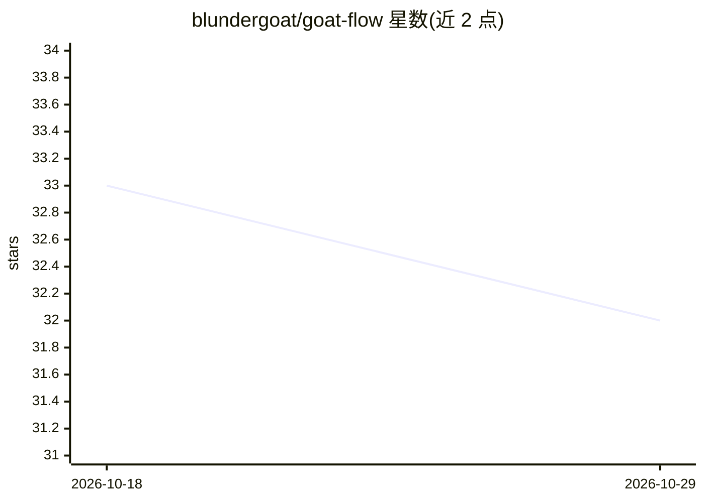

# blundergoat/goat-flow

⭐ 32 · TypeScript · MIT · 推送 2026-10-27 · [GitHub](https://github.com/blundergoat/goat-flow) · [官网](https://goat-flow.com) · 个人维护

**给 AI 编程 agent 的 harness 工程系统与本地仪表盘**

面向 Claude Code、Codex、Antigravity CLI、Copilot CLI 四种编码 agent 的 harness 管理工具：安装确定性系统文件、部署执行循环（READ→SCOPE→ACT→VERIFY）、八个技能工作流、防护钩子与跨会话学习循环，并通过 manifest 注册表在四种 agent 间保持同一 harness。本地仪表盘提供审计、提示词、终端会话、计划跟踪等视图；另有完整 CLI 用于 CI 与脚本。限制：嵌入终端需可选 node-pty 编译，凭据脱敏自述非完善 DLP。

## 筛选速览

| 维度 | 判定 | 备注 |
|---|---|---|
| AI 角色 | `ai-ecosystem` | LLM/agent 周边工具 |
| 许可风险 | `permissive` | MIT |
| 部署形态 | `library` | 以包/库形式分发 |
| 模型依赖 | — | README 未给出锁定关系 |
| 硬件要求 | — | 无带数字的原话,不猜 |
| 安装摩擦 | `medium` | 含编译或系统依赖之一 |
| 成熟度 | — | 结构信号不足 |

## 能力要点

- manifest 注册表使同一 harness 覆盖四种编码 agent
- 工具级钩子拦截危险命令、仓库发布与密钥路径访问
- 学习循环将已验证失败转为可复用教训
- 本地仪表盘含审计、24 个提示词预设、PTY 终端会话

## 适用场景

- 为编码 agent 安装结构化工作流与防护钩子
- 跨 Claude Code/Codex/Copilot 对比审计 harness 配置
- 在 CI 中用 CLI 命令做确定性审计与评分

## 场景标签

`提示工程` · 领域:Agent 开发

## 证据(README 行号)

> L3: **An AI coding agent harness and local dashboard for Claude Code, OpenAI Codex, Google Antigravity, and GitHub Copil
> L5: GOAT Flow audits agent setup, installs guardrails and deny hooks, provides structured `/goat-*` workflows, and prese
> L133: GOAT Flow's manifest-backed registry supports **Claude Code, Codex, Google Antigravity, and Copilot CLI**. Their i

## 星数曲线

2026-10-18 33 → 2026-10-29 32（-1）

---
*卡片 v1 · prompt 1.4 · 生成 2026-10-25 · 置信度 high · 依据 README sha `36355e33b5b6` · [字段定义](../../DATASET.md)*
